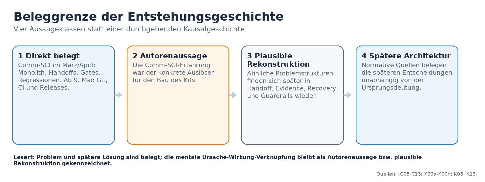
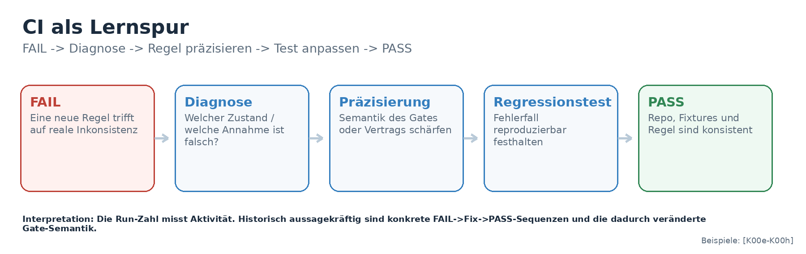
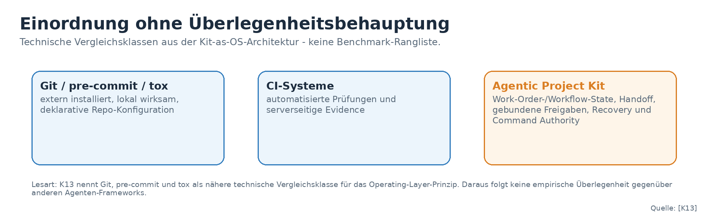
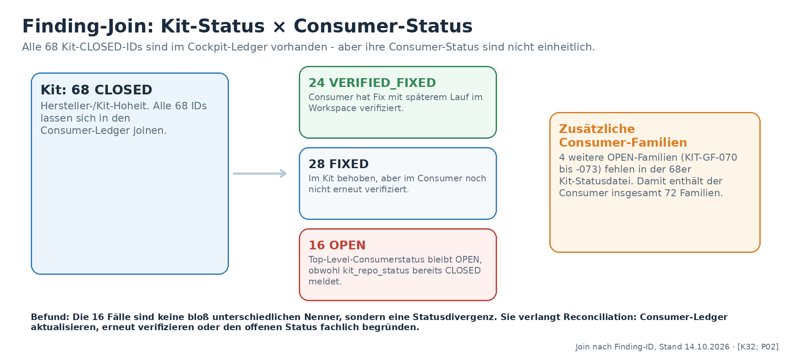
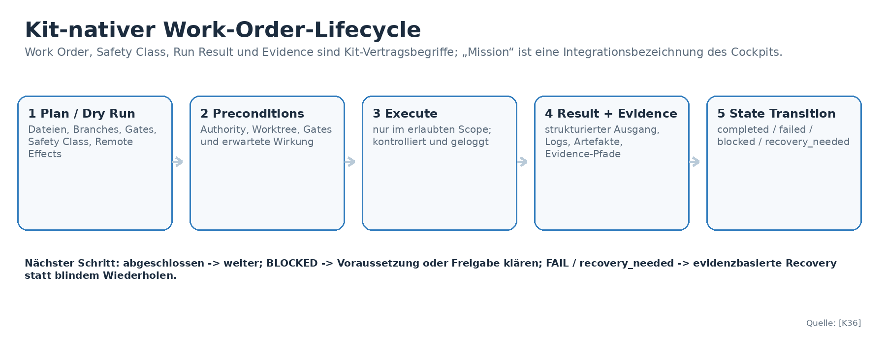
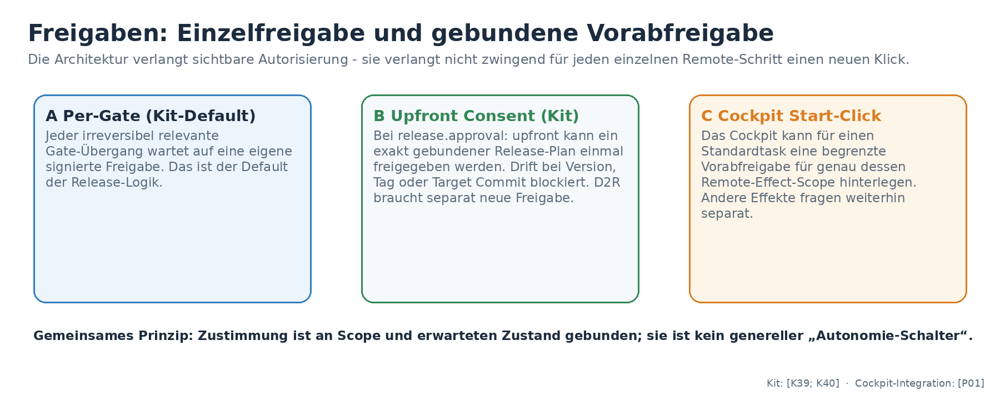
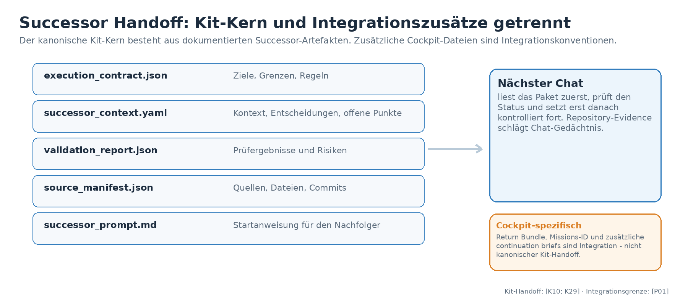
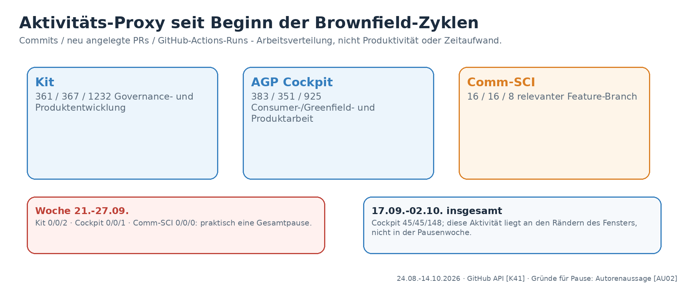

# Agentic Project Kit – Historie, Self-Hosting und Driftkontrolle (redigierte Textfassung)

Status: historische Evidence, vorläufig; redigierte Markdown-Fassung der Ergänzungsrevision vom 15.10.2026  
Herkunft: DOCX `Agentic_Project_Kit_Historie_Selfhosting_Drift_Ergaenzung_2026-10-15.docx` (SHA-256 in `SOURCE_MANIFEST.json`), mechanisch nach Markdown konvertiert; Redaktionen R1–R5 siehe `README.md`.  
Diese Datei ist Evidence, keine Governance-Regel und keine Direction-Entscheidung.

---

**Von der Modularisierungsnot in Comm-SCI-Control-private zum kontrollierten Operating Layer für KI-gestützte Repository-Arbeit**

<table>
<colgroup>
<col style="width: 100%" />
</colgroup>
<thead>
<tr class="header">
<th><strong>Ziel des Berichts 
</strong>Die Entstehungsgeschichte, Architektur und heutige Funktion des Kits werden aus Git-/CI-, Release-, Architektur- und Consumer-Evidence rekonstruiert. Historische Fakten, Autorenaussagen, plausible Rekonstruktion und Bewertung bleiben methodisch getrennt.</th>
</tr>
</thead>
<tbody>
</tbody>
</table>

| **Kennzahl**      | **Stand / Bedeutung**                                                                                            |
|-------------------|------------------------------------------------------------------------------------------------------------------|
| Erster Kit-Commit | 9\. Mai 2026, 13:17:51 MESZ - Version 0.1.0 \[K00a; K00b\]                                                       |
| Erster Release    | v0.2.0 am 9. Mai 2026, 14:01:59 MESZ \[K00d\]                                                                    |
| Stand             | v1.0.25; 91 veröffentlichte Releases \[K01; K34\]                                                                |
| Command Surface   | 266 manifestierte Kommandos: 34 Orchestratoren, 126 Diagnostics, 106 Primitives \[K31\]                          |
| Greenfield        | 68 Kit-CLOSED; im direkten Consumer-Join davon 24 VERIFIED_FIXED, 28 FIXED, 16 OPEN \[K32; P02; K42\]            |
| Consumer-Ledger   | 72 Familien insgesamt; zusätzlich 4 OPEN-Familien (070-073), die in der 68er Kit-Statusdatei fehlen \[P02; K42\] |

GitHub-Datenschnitt: 14. Oktober 2026; redaktionelle Ergänzung: 15. Oktober 2026 (Self-Hosting und vorläufiger Drift-Audit). Der neue Befundteil stützt sich auf commit-gepinnte PRs, Kit-/Consumer-Testberichte und die GitHub-Auswertung in Issue \#2505. Historische Fakten, Autorenaussagen, Rekonstruktion und Bewertung bleiben getrennt.

# 0. Kurzfassung

Der Ausgangspunkt dieser Geschichte ist eine konkrete technische und prozessuale Überlastung: Comm-SCI-Control-private wurde im März und April 2026 unter laufender Nutzung modularisiert. Ein ungefähr 16.000 Zeilen großer Legacy-Wrapper, viele versteckte Laufzeitkopplungen, lange Chat-Handoffs, Pflicht-Gates, Logkontrolle, ACTUAL-E2E-Tests und spätere Restore-Commits zeigen, dass nicht nur Code zerlegt, sondern ein komplexer Arbeitszustand zuverlässig über viele KI-gestützte Schritte hinweg erhalten werden musste. \[C05-C13\]

Die Aussage, dass genau diese Erfahrung den Entschluss zum Agentic Project Kit auslöste, stammt vom Autor. Die Quellen belegen die Problemlage und die spätere Lösungsarchitektur, aber sie beweisen keine lückenlose mentale Ursache-Wirkung-Kette. Der Bericht behandelt die Verbindung deshalb als stark plausible Rekonstruktion und nicht als vollständig externe Kausalitätsbeweisführung.

Die frühe Git-Historie schließt die Lücke vor v0.2.0: Der Root-Commit vom 9. Mai enthält bereits Version 0.1.0 mit Handoff-, Gate-, Evidence- und Statusideen; 51 Sekunden später wird das GitHub-Repository angelegt, rund 22 Minuten später läuft die erste CI, und nach etwa 44 Minuten erscheint v0.2.0 als erster veröffentlichter Release. Ab diesem Punkt wird CI zur historischen Lernspur: FAIL -\> Diagnose -\> Fix -\> PASS dokumentiert wiederholt, wie die Semantik von Gates und Verträgen präzisiert wird. \[K00a-K00h\]

Ab Juli/August verschiebt sich das Kit vom Generator zu einem Operating Layer für bestehende Repositories. Brownfield-, Greenfield-, sampleproject-, PyPI-/Docker- und Cockpit-Tests zeigen reale externe Fehlermuster. Diese Evidenz ist wertvoll, aber nicht unabhängig im wissenschaftlichen Sinn: Comm-SCI und Cockpit stammen aus demselben Projektumfeld, viele Reports werden vom Kit über das Kit erzeugt. \[K13; K16-K26\]

Heute kann das Kit Repository-Arbeit strukturieren, Work Orders und Lifecycle-Orchestratoren kontrolliert ausführen, Zustände und Regeln prüfen, Handoffs erzeugen, PR-/CI-/Merge-/Post-Merge-Lifecycles steuern, Releases absichern, Recovery führen und eine optionale GUI über dieselben Backend-Verträge legen. Sein Nutzen liegt vor allem in Kontrolle und Nachvollziehbarkeit, nicht in autonomer Codegenerierung. \[K29-K36\]

Neue Erkenntnis der Ergänzungsrevision: Das konsequente Self-Hosting ist nicht nur ein Testverfahren, sondern nach Einschätzung des Autors der zentrale Beschleuniger seiner Soloentwicklung. Technisch nachvollziehbar ist eine Rückkopplung aus kurzen KI-Arbeitszyklen, dauerhafter Repository-Evidence, kontrollierten Handoffs, Freigaben und Recovery. Für bestimmte zuvor fehlerhafte Driftmechanismen liegen reparierte und getestete Schutzpfade vor, aber keine belastbare Zeitreihe der gesamten Driftrate. \[AU03; K10; K46-K49\]

<table>
<colgroup>
<col style="width: 100%" />
</colgroup>
<thead>
<tr class="header">
<th>
<strong>Kritische Einordnung</strong>

Die Historie ist stärker belegt als jede Aussage über Produktivität oder Überlegenheit. 91 Releases, 266 Kommandos und 68 Kit-seitig geschlossene Findings zeigen hohe Entwicklungs- und Härtungsaktivität; sie belegen noch nicht, wie viele Stunden, Fehler oder Brownfield-Zyklen das Kit netto spart. Deshalb werden Kosten/Nutzen, Consumer-Verifikation und Versionspraxis in einem eigenen Bewertungskapitel behandelt.
</th>
</tr>
</thead>
<tbody>
</tbody>
</table>

# Inhalt

1\. Quellenlage, Methode und Beleggrenzen

<table>
<colgroup>
<col style="width: 100%" />
</colgroup>
<thead>
<tr class="header">
<th>
<strong>Hinweis zur Rekonstruktion</strong>

Die frühe Kausalgeschichte verbindet eine vom Autor benannte Ursache mit historischen März-/April-Belegen. Direkt nachweisbar sind Problemdruck und spätere technische Antworten. Nicht als Quellenaussage ausgegeben wird der innere Entscheidungsprozess des Autors. Die frühere Lücke bis v0.2.0 ist dagegen durch Root-Commit, Repository-Anlage, erste CI, ersten Release und frühe FAIL-&gt;Fix-&gt;PASS-Sequenzen sehr dicht dokumentiert.
</th>
</tr>
</thead>
<tbody>
</tbody>
</table>

2\. Historische Rekonstruktion in acht Phasen

3\. Comm-SCI im März/April: der Problemraum vor dem Kit

4\. Geburt des Kits: v0.1.0, v0.2.0 und CI als Lernspur

5\. Vom Workflow-Kernel zum Operating Layer

6\. Externe Validierung: Brownfield, Greenfield und öffentliches Produkt

7\. Consumer-getriebene Härtung bis v1.0.25

7.4 Self-Hosting: technische Selbstverstärkung und Drift-Fallkette

8\. Wie das Kit prinzipiell funktioniert

9\. Was das Kit heute leistet

10\. Was es nicht leistet und wo Grenzen liegen

11\. Kritische Bewertung: Nutzen, Overhead, Evidenz und Versionierung

11.9 Erste empirische Befunde zur Driftkontrolle und ihr Geltungsbereich

11.10 Governance-Aufwand und Grenzen der historischen Messung

12\. Offene Pläne und nächste Entwicklungslinien

13\. Gesamturteil

Anhang A: Glossar

Anhang B: Architekturentscheidungen und Quellen

Anhang C: Quellenregister

Anhang D: Änderungen gegenüber der Vorfassung (Redaktionshistorie)

Anhang E: Finding-ID-Einzelabgleich (reproduzierbarer Stichtag)

# 1. Quellenlage, Methode und Beleggrenzen

Diese Rekonstruktion nutzt zwei GitHub-Repositories: das öffentliche vfi64/agentic-project-kit und für die Vorgeschichte das private vfi64/Comm-SCI-Control-private. Für Comm-SCI werden historische März-/April-Stände, Modularisierungsplanung, Übergabeprompts, Format-Memory, AGENTS-Regeln und konkrete Regression-/Restore-Commits verwendet. Für das Kit kommen Root-Commit, Repository-Metadaten, Actions/CI, Releases, Architektur- und Governance-Dokumente, Project Direction, Status, Command Manifest und Greenfield-Ledger hinzu. \[C05-C13; K00a-K38\]

Die Quellenklassen werden unterschiedlich gewichtet: Git-/Release-/CI-Ereignisse belegen konkrete Zustände oder Abläufe; Architekturverträge belegen normative Entscheidungen; Reports belegen eine Prüfung zu einem bestimmten Ref; Pläne belegen Absichten, nicht zwingend Umsetzung. Eine spätere Implementierung darf daher einen älteren Plan überholen. \[K14; K28; K30; K34\]

| **Aussageklasse**        | **Behandlung in diesem Bericht**                                                                                                              |
|--------------------------|-----------------------------------------------------------------------------------------------------------------------------------------------|
| Direkt belegt            | Git-SHA, CI-Run, Release, aktueller Status, konkreter Test-/Reportbefund.                                                                     |
| Autorenaussage           | Die Comm-SCI-Erfahrung war der konkrete Auslöser für den Bau des Kits.                                                                        |
| Plausible Rekonstruktion | Die Struktur der Comm-SCI-Probleme passt zu späteren Kit-Lösungen; der Übergang wird erklärt, aber nicht als alleinige Kausalität behauptet.  |
| Selbstevaluation         | Aussagen zu Reife, Nutzen und Grenzen beruhen überwiegend auf Projekt- und Consumer-Evidence und werden ausdrücklich als Bewertung behandelt. |

Abbildung 1: Beleggrenze der Entstehungsgeschichte. Direkte Evidenz, Autorenaussage, plausible Rekonstruktion und spätere normative Architektur werden getrennt behandelt.

<table>
<colgroup>
<col style="width: 100%" />
</colgroup>
<thead>
<tr class="header">
<th>
<strong>Wichtige methodische Einschränkung</strong>

Comm-SCI-Control-private ist privat. Die zentralen März-/April-Belege sind für den Autor prüfbar, aber für externe Leser ohne Repository-Zugriff nicht unabhängig reproduzierbar. Das schwächt nicht die interne Rekonstruktion, begrenzt aber ihre öffentliche Nachprüfbarkeit.
</th>
</tr>
</thead>
<tbody>
</tbody>
</table>

# 2. Historische Rekonstruktion in acht Phasen

Die Entwicklung wird in acht Phasen gegliedert. Die Phasen beruhen auf unterschiedlichen Evidenzklassen: frühe Comm-SCI-Quellen, Git-/CI-Ereignisse, Architekturverträge, Releases und externe Consumer-Artefakte. Für 17. September bis 2. Oktober zeigen die GitHub-Daten keine durchgehende Verlagerung: Die Woche 21.-27. September ist in allen drei Repositories praktisch eine Gesamtpause; die Cockpit-Aktivität des größeren Fensters liegt vor allem an dessen Rändern. \[K41; AU02\]

*(Abbildung im öffentlichen Archiv durch die Phasentabelle in Abschnitt 4 ersetzt.)*

Abbildung 2: Acht Entwicklungsphasen. Die September-Lücke enthält eine echte Gesamtpause; die Cockpit-Aktivität des größeren Fensters liegt an dessen Rändern. Gründe der Pause sind als Autorenaussage getrennt von den Repo-Daten ausgewiesen. \[K41; AU02\]

| **Zeitraum**     | **Phase**                                        | **Kernverschiebung**                                                                                                                                                  |
|------------------|--------------------------------------------------|-----------------------------------------------------------------------------------------------------------------------------------------------------------------------|
| März-April       | Comm-SCI als Problemraum                         | 16k-Monolith, Handoffs, Gates, Regressionen, Anti-Regression-Memory. \[C05-C13\]                                                                                      |
| 9.-12. Mai       | v0.1.0 bis v0.3.x                                | Root-Commit, erste CI, erster Release, Architecture Contract, Validatoren, Reports und Workflow-State. \[K00a-K09\]                                                   |
| Mai-Juni         | Workflow und Evidence                            | State Machine, Recovery, Successor-Handoff, GUI-/Contract-Readiness. \[K10-K12; K36\]                                                                                 |
| Juli-13. Aug     | Operating Layer                                  | Kit-as-OS, .agentic/-Workspace, DPA, Brownfield-/Greenfield-Validierung. \[K13; K15-K21; K35\]                                                                        |
| 14.-23. Aug      | Öffentliches Produkt                             | PyPI/Docker First Contact, Onboarding, Hermes-Grenze. \[K22-K25\]                                                                                                     |
| 24\. Aug-16. Sep | Externe Zyklen                                   | Comm-SCI-Wartungszyklen und AGP-Cockpit-Greenfield-Findings. \[K26-K27; K38\]                                                                                         |
| 17\. Sep-2. Okt  | Gesamtpause + Cockpit-Schwerpunkt an den Rändern | 21.-27.09.: Kit 0/0/2, Cockpit 0/0/1, Comm-SCI 0/0/0. Im Gesamtfenster 17.09.-02.10. liegen 45 Cockpit-Commits/PRs und 148 Runs vor allem davor/danach. \[K41; AU02\] |
| 3.-14. Okt       | v1.0.14 bis v1.0.25                              | Release-, Recovery-, CI-, Kit-Update- und GUI-Härtung; aktueller Stand v1.0.25. \[K28; K30; K33-K34\]                                                                 |

# 3. Comm-SCI im März/April: der Problemraum vor dem Kit

## 3.1 Modularisierung als Prozessproblem, nicht nur als Codeproblem

Ende Februar dokumentiert MODULARIZATION.md für src/Comm-SCI-Control-App.py 16.188 Zeilen. Die Strategie setzt deshalb auf kleine regression-sichere Schnitte, Acceptance-Checklisten und manuelle pywebview-Smokes statt Big-Bang-Refactoring. Im März läuft parallel ein eigener Output-/Rendering-Track, während weiterhin Logik und Fallbacks im Monolith liegen. \[C05\]

Die dokumentierte Arbeitsdichte ist hoch, ohne dass die Commit-Zahl selbst als Qualitätsmaß verstanden werden darf: Zwischen 1. und 18. März wurden 125 Commits gezählt, 32 davon am 13. März. Entscheidend ist, was die Handoffs verlangen: nach jedem Patch Tests, ACTUAL-E2E-Anpassung, Logprüfung, Git-Sicherheitsregeln und sogar eine Schätzung der Kontextfenster-Auslastung. Das Chatfenster wurde damit selbst zu einem knappen Betriebsressourcenproblem. \[C06; C13\]

## 3.2 Repository-Memory, dirty worktree und Wiederherstellung

Der Handoff vom 20. März verlangt Git-Status, reproduzierbare Profilfälle und Log-first-Diagnose, bevor Prompt-, Compiler-, Formatter- und Integrationspfade verändert werden. Format-Memory.md fungiert als langlebige Anti-Regression-Memory mit Full-Read-, Backup-, Merge- und Konfliktregeln. Das ist keine generische Kit-Architektur, aber bereits eine projektspezifische Antwort auf denselben Grundbedarf: Zustand muss außerhalb des flüchtigen Chats konserviert und vor Änderungen geprüft werden. \[C07; C08\]

Der April zeigt die technische Härte: Ein content-loss regression wird mit Guard-Test repariert; der große App2-Schnitt vom 20. April verändert 17.006 Zeilen; anschließend folgen Fix- und Restore-Commits für Desktop-Startup, Provider-Panel-Switching, Gemini-Reconnect und Provider-Call-Helpers. Fortschritt und Regression liegen eng beieinander. \[C10-C12\]

| **Comm-SCI-Erfahrung**                      | **Spätere Kit-Lösungsform - als Rekonstruktion, nicht als Kausalitätsbeweis** |
|---------------------------------------------|-------------------------------------------------------------------------------|
| 16k-Monolith, versteckte Laufzeitkopplungen | Später: bounded slices, Architekturgrenzen, Preflights                        |
| Lange Übergabeprompts, Kontextdruck         | Später: repo-backed Successor Handoff Package                                 |
| Gate + E2E + Log nach jedem Patch           | Später: deterministische Checks und strukturierte Evidence                    |
| Dirty worktree, Laufzeitartefakte           | Später: Worktree-Preflights, volatile carriers, guarded mutation              |
| Format-Memory mit Backup-/Merge-Regeln      | Später: State-/Rule-/Document-Governance und Freshness                        |
| Regressionen nach großen Schnitten          | Später: fail-closed Recovery und idempotente Wiederaufnahme                   |
| JSON als normative Autorität                | Später: Authority-Hierarchie und Semantic Quality Boundary                    |

# 4. Geburt des Kits: v0.1.0, v0.2.0 und CI als Lernspur

## 4.1 Der eigentliche Ursprung ist v0.1.0

Der Root-Commit 80e58fd6 vom 9. Mai 2026, 13:17:51 MESZ, heißt „Initialize agentic project generator MVP“ und nennt im pyproject.toml Version 0.1.0. Bereits enthalten sind README, Design-Notizen, Generator-/GitHub-Module und Tests. Handoff, Test-Gates, maschinenlesbare TODOs, Evidence und die Trennung stabiler Regeln von volatilem Zustand sind im ersten Stand erkennbar. \[K00a; K00b\]

GitHub weist die Repository-Anlage 51 Sekunden später aus. Um 13:40:16 startet CI Run \#1 erfolgreich; gegen 14:01 Uhr erscheint v0.2.0. Die öffentlich sichtbare 0.1.0-Phase ist deshalb real, aber extrem kurz. v0.2.0 war der erste Release, nicht der Entwicklungsbeginn. \[K00c; K00d\]

## 4.2 CI als Entwicklungsprotokoll

CI-Zahlen werden nicht als Commit-Zähler gelesen. Push und Pull Request können denselben SHA mehrfach prüfen. Historisch wichtig sind die konkreten FAIL/PASS-Sequenzen: Release-State, Remote-Release, Version Drift, Architecture Contract, Dokument-Coverage und Semantic Quality Boundary brechen zunächst, werden semantisch präzisiert und anschließend grün. \[K00e-K00h\]

Abbildung 3: CI als Lernspur. Historisch aussagekräftig sind konkrete FAIL-\>Fix-\>PASS-Sequenzen, nicht die bloße Run-Zahl. \[K00e-K00h\]

| **Tag**  | **Actions-Ereignisse**   | **Historisch sichtbare Entwicklung**                                                                           |
|----------|--------------------------|----------------------------------------------------------------------------------------------------------------|
| 9\. Mai  | 169 CI-Runs / 21 failure | Release-State, Remote-Release, Doctor- und Citation-Drift werden präzisiert. \[K00e\]                          |
| 10\. Mai | 168 / 47                 | Architecture Contract, Dokument-Coverage, Project Contracts, Policy Packs, Semantic Quality Boundary. \[K00f\] |
| 11\. Mai | 220 / 0                  | Stabilisierung; v0.2.6-v0.2.10, Validatoren, Wrapper und JSON-Reports. \[K00g\]                                |
| 12\. Mai | 196 / 10                 | v0.2.11/v0.3.x; Workflow-Runner und Release-Check-Coverage durchlaufen Recovery-Fixes. \[K00h\]                |

## 4.3 Vom Generator zur Governance-Grundlage

Zwischen v0.2.3 und v0.3.1 entstehen Status-/Release-Gates, doctor, Architecture Contract, Policy Packs, Output Contracts, JSON-Reports, Report-Schemata, Collaboration-/Transfer-Regeln und ein deklarativer Workflow-Runner. Der Systemwechsel ist wichtiger als die Versionsnummer: Chat-Prosa wird zunehmend durch Dateien, Schemata, Zustände, Gates und Evidence ersetzt. \[K02-K09\]

Eine wichtige Alternativerklärung gehört ausdrücklich dazu: Mit v0.2.5 fließen externe Forschungsinputs zu agentischem Coding in den Architecture Contract ein. Sie können den Ursprung des Kits nicht erklären, weil der 0.1.0-MVP und zentrale Handoff-/Gate-/Evidence-Ideen bereits am 9. Mai davor existieren. Sie sind aber eine plausible zusätzliche Quelle für die spätere Formalisierung und Begriffsschärfung der Architektur. Die Entwicklung ist daher nicht als monokausale Ableitung aus Comm-SCI zu lesen. \[K00b; K03\]

# 5. Vom Workflow-Kernel zum Operating Layer

Im restlichen Mai und Juni wird der Arbeitsschritt selbst zum modellierten Zustand. Der spätere Work-Order-Vertrag beschreibt Zustände wie empty, prepared, running, completed, failed, blocked und recovery_needed. Wiederholte Ausführung soll keine Doppelmutation erzeugen; Merge-/Release-Readiness soll nicht aus improvisierter Chat-Interpretation entstehen. \[K36\]

v0.4.x verschiebt den Schwerpunkt von Oberfläche zu Command Authority, Handoff-Freshness, PR-/CI-Gates, Post-Merge-Loops, Successor-Packages und Release-Lifecycles. Der Documentation-System-Closeout macht Handoffs zu einem Paket aus successor_context.yaml, source_manifest.json, validation_report.json, execution_contract.json und erzeugtem Prompt. Repository-Artefakte werden langlebige Wissensquelle; der Chat wird zur austauschbaren Interaktionsoberfläche. \[K10; K28\]

Die am 4. Juli akzeptierte Kit-as-OS-Architektur formalisiert Operating-Layer Mode für bestehende Repositories. „OS“ ist dabei bewusst metaphorisch: Das Kit ist Gast im fremden Repository und arbeitet im reservierten .agentic/-Namespace. Die Architektur nennt Git, pre-commit und tox als nähere technische Vergleichsklasse: extern installiert, lokal wirksam und über Repository-Konfiguration gebunden. \[K13\]

Abbildung 4: Technische Architektur-Einordnung ohne Benchmark- oder Überlegenheitsbehauptung. Die Vergleichsklasse stammt aus der Kit-as-OS-Architektur selbst. \[K13\]

v0.5.0 integriert zusätzlich die Document Projection Architecture (DPA). DPA regelt Dokumentautorität, Registries, Lifecycle, Rendering, Freshness, Concurrency und Migration. Ihre Stable-Promotion ist ausdrücklich keine automatische Konformitätszusage für fremde Repositories. \[K35\]

# 6. Externe Validierung: Brownfield, Greenfield und öffentliches Produkt

## 6.1 Self-Hosting wird als unzureichend erkannt

Am 11. August endet der read-only Brownfield-Test gegen Comm-SCI bewusst mit FAIL_SAFE: Das Kit erkennt eine fremde Governance- und Spezifikationslandschaft und verweigert automatische Adoption. Gleichzeitig entdeckt der Test einen generischen Inventurdefekt im Kit. Der anschließende Adoption-Probe zeigt weitere Self-Hosting-Annahmen in Health- und Handoff-Pfaden. \[K16; K17\]

Parallel erhält der Greenfield-Test PASS_WITH_LIMITATIONS. Gefunden werden unter anderem fehlendes .gitignore, Reibung zwischen Generator- und Operating-Layer-Modus und unvollständige External-Workspace-Handoff-Voraussetzungen. Das ist methodisch wichtig, weil hier Fehler sichtbar werden, die das Kit bei der Entwicklung mit sich selbst nicht gesehen hatte. \[K18\]

## 6.2 Neutraler und öffentlicher First Contact

Ein neutraler Test gegen pypa/sampleproject verhindert, dass aus Comm-SCI-spezifischen Annahmen eine allgemeine Architektur abgeleitet wird. Danach folgt ein frischer Docker-/PyPI-First-Contact mit agentic-project-kit==1.0.1, der zugleich erfolgreiche Installation und echte First-Contact-Defekte zeigt. \[K21; K23\]

Onboarding wird am 23. August als eigenes Messproblem behandelt. Am selben Tag wird die Executor-Grenze festgezogen: Hermes kann Ausführungsadapter sein, aber Command-, Rule-, State-, Release- und Handoff-Autorität bleiben Kit-owned. \[K24; K25\]

<table>
<colgroup>
<col style="width: 100%" />
</colgroup>
<thead>
<tr class="header">
<th>
<strong>Evidenzqualität</strong>

Brownfield, Greenfield, sampleproject und Public-PyPI sind unterschiedliche Evidence-Klassen. Sie erhöhen die Aussagekraft gegenüber reinem Self-Hosting, sind aber keine unabhängige wissenschaftliche Produktstudie. Comm-SCI und Cockpit bleiben Projekte desselben Autors.
</th>
</tr>
</thead>
<tbody>
</tbody>
</table>

# 7. Consumer-getriebene Härtung bis v1.0.25

Comm-SCI bleibt reales Brownfield-Prüffeld. Cycle 007 vom 31. August verschiebt elf Provider-Settings-Methoden aus der Legacy-Delegation, reduziert den gemessenen Seam von 55 auf 44 und bringt den Produkt-PR einschließlich Successor-Refresh bis READY. Der aktuelle Status behandelt diesen Cycle als letzte committed completed-cycle baseline; Cycle 008 soll vor Fortsetzung revalidiert werden. \[K38; K30\]

Ab September wird das AGP Cockpit zum besonders aggressiven Greenfield-Consumer. Die Finding-Familien treiben Reparaturen in PR-Lifecycle, Handoff, CI, Release, Rule-Acknowledgement, Recovery, Kit-Discovery und Evidence. Ein direkter Join nach Finding-ID zeigt: Alle 68 Kit-seitig CLOSED geführten IDs kommen im Cockpit-Ledger vor. Davon stehen dort 24 auf VERIFIED_FIXED, 28 auf FIXED und 16 weiterhin auf OPEN. Zusätzlich enthält der Consumer vier neue OPEN-Familien KIT-GF-070 bis KIT-GF-073, die in der 68er Kit-Statusdatei noch fehlen. \[K32; P02; K42\]

Abbildung 5: Direkter Finding-ID-Join. Von 68 Kit-CLOSED-Familien sind im Consumer 24 VERIFIED_FIXED, 28 FIXED und 16 weiterhin OPEN; vier weitere Consumer-OPEN-Familien fehlen in der 68er Kit-Statusdatei. \[K32; P02; K42\]

Der Join macht eine echte Statusdivergenz sichtbar. Bei 16 Familien lautet der Top-Level-Consumerstatus OPEN, obwohl der im selben Consumer-Datensatz eingebettete kit_repo_status bereits CLOSED meldet. Aus den Daten allein folgt nicht, welche Seite fachlich korrigiert werden muss: möglich sind ein noch ausstehender Retest, ein veralteter Consumerstatus oder eine Kit-Schließung, die der Consumer noch nicht akzeptiert. Der Widerspruch darf deshalb weder als Erfolg noch als Fehlschlag verrechnet werden; er ist selbst ein Reconciliation-Finding. \[K42\]

## 7.1 Die bisherige Lücke 17. September bis 2. Oktober

Zwischen 17. September und 2. Oktober zeigt das öffentliche Kit-Repository 0 Default-Branch-Commits, keinen Release, 2 erst am 2. Oktober eröffnete PRs und 6 Actions-Runs. Für das Cockpit stehen im selben Gesamtfenster 45 Commits, 45 PRs und 148 Runs; Comm-SCI zeigt 0/0/0. Die Wochenauflösung ist entscheidend: Vom 21.-27. September liegen alle drei Repositories praktisch bei null (Kit 0/0/2, Cockpit 0/0/1, Comm-SCI 0/0/0). Die 45 Cockpit-Commits des Gesamtfensters liegen damit an dessen Rändern, nicht in der Pausenwoche. \[K41\]

Autorenaussage \[AU02\]: Die Pausen sind nicht als Projektstillstand oder strategische Krise zu deuten. Für die September-Pause nennt der Autor ausgeschöpfte Nutzungslimits bei Claude/Codex und die Tatsache, dass die Entwicklung in begrenzter Freizeit stattfindet. Diese Erklärung ist persönliche Kontextinformation, keine GitHub-Evidence.

## 7.2 1.0.24/1.0.25

v1.0.24 ergänzt am 13. Oktober eine optionale Guided GUI über die gemeinsamen guarded workflows. v1.0.25 stärkt externe Reproduzierbarkeit, Finding-Export, Rule-Inventory, archivierte Release-Evidence, Workspace-owned Kit-Auflösung und Publish-Verdicts. Der Command Manifest umfasst 266 Kommandos; gleichzeitig bleibt Decomplexification als eigener Plan bestehen. \[K31; K33; K34; K37\]

## 7.3 Konsequent eingesetztes Self-Hosting als Entwicklungsbeschleuniger

Autorenaussage \[AU03, 15.10.2026\]: Die Geschwindigkeit, mit der das Agentic Project Kit allein in begrenzter Freizeit entwickelt wurde, war nach Einschätzung des Autors nur durch den konsequenten Einsatz des Kits auf seinen eigenen Entwicklungsprozess erreichbar. Derselbe Steuerungs- und Handoff-Gewinn beschleunigt nach seiner Einschätzung die Entwicklung des AGP Cockpits erheblich. Gemeint ist keine logische Unmöglichkeit ohne Kit, sondern ein Selbstverstärkungseffekt: Ein Werkzeug für persistente Zustände, Gates, Recovery und Work-Order-Lifecycles ermöglicht die zügige Härtung genau dieser Funktionen. \[AU03; K10; K36\]

Die Git-/CI-Historie und die zahlreichen Consumer-Zyklen belegen hohe Entwicklungsaktivität und technisch dokumentierte Rückkopplung, nicht die kontrafaktische Geschwindigkeit einer parallelen Entwicklung ohne Kit. Dass Comm-SCI vor dem Kit grundsätzlich entwickelt und modularisiert werden konnte, widerspricht der engeren Autorenaussage nicht: Die Behauptung betrifft die erreichte Geschwindigkeit bei häufigen Unterbrechungen. Offen bleibt, welcher Anteil des heutigen Kommandoumfangs hierfür tatsächlich nötig ist. \[C05–C13; K41; AU03\]

## 7.4 Self-Hosting: technische Selbstverstärkung und Drift-Fallkette

Mechanismus der Selbstverstärkung (analytische Rekonstruktion): KI-gestützte Entwicklung erhöht die Zahl paralleler Entscheidungen und potenziell den Kontextverlust zwischen Sitzungen. Die Kit-Schicht konserviert Arbeit als versionierten Zustand, bindet Mutationen an Work Orders, eindeutige IDs und Freigaben, hält Handoff- und Prüfberichte bereit und verlangt nach einem Fehlschlag diagnostizierbare Wiederaufnahme statt improvisierter Wiederholung. Dadurch können viele kurze Entwicklungsfenster aneinander anschließen. Derselbe Mechanismus steht nach Autorenaussage auch dem Cockpit zur Verfügung. Das ist eine technisch plausible Wirkungsweise und beobachtete Nutzungspraxis, kein isoliertes Produktivitätsexperiment. \[AU03; K10; K36; K46-K49\]

28\. Mai – zwei voneinander getrennte Selbstreferenzfehler: PR \#877 beseitigte eine Schleife, in der ein Successor-Prompt seinen eigenen bereits aktualisierten Marker voraussetzte. PR \#880 behandelte eine weitere Schleife, ausgelöst durch Ketten administrativer Git-Merges, ohne die Freshness-Grenze gegenüber Produkt-Merges aufzuweichen. Beide PRs wurden gemergt; die PR-Beschreibungen dokumentieren konkrete Reparaturen und lokale Prüfungen. \[K46; K47\]

12\. Juni – dokumentierte Stabilisierung: Der Documentation-System-Closeout hält für reine Handoff-Refreshs „result=NOOP“, „refresh_required=False“ und „next_safe_action=none“ fest. Er beschreibt einen prüfbaren Successor-Vertrag mit execution_contract.json, source_manifest.json und validation_report.json. Dies belegt die für diese Konfiguration geprüfte Beseitigung einer administrativen Refresh-Schleife, jedoch nicht deren Häufigkeit im gesamten Entwicklungsbetrieb. \[K10\]

4\. Oktober – externe Rückkopplung KIT-GF-011: Die Final-HEAD-Identität eines Successor-Pakets wurde explizit modelliert. Ein reiner Refresh-Nachfolger kann unter der Bedingung refresh_only_descendant zulässig sein, obwohl der Generierungs-HEAD hinter dem finalen Git-HEAD liegt. Regressionen und Kit-Gates wurden berichtet; der untersuchte Cockpit-Ledger führt die Familie als VERIFIED_FIXED. Die Korrektur verhindert insbesondere, dass ein administrativer Refresh selbst neuen Freshness-Alarm erzwingt. \[K48; P02\]

10\. Oktober – externe Regression KIT-GF-017: Ein installiertes Release-Wheel 1.0.21 und ein Candidate-Wheel 1.0.22 durchliefen jeweils fünf kontrollierte Szenarien. Die acht negativen Ausführungen (fehlende anfängliche Carriers, rote CI, geänderter PR-HEAD, dirty Produktdatei je Version) blockierten wie erwartet; die zwei regulären positiven Testabläufe bestanden. Alle zehn Szenarien nutzten lokale Transportdoubles und simulierte Remote-Wirkung – kein tatsächlich durchgeführter Live-GitHub-Merge. Der spätere Consumerstatus war FIXED, nicht VERIFIED_FIXED; die eigenständige Consumer-Akzeptanz blieb offen. \[K49; P02\]

13\. Oktober – Positivkontrolle einer zulässigen Fortschreibung: Der administrative PR \#2504 führte von Paket-Generation-HEAD 6b2cfe62 zum Nachfolger ef78a255. Ein Git-Vergleich zeigt einen Commit mit 13 geänderten Handoff-/Status-/Evidence-Dateien, ohne Änderung an Produktquellcode. Dies ist zunächst ein ALLOWED_ADVANCE-Kandidat, keine bewiesene Statusdrift; der echte Vertragsscheck ist für die Gesamtauswertung noch zu reproduzieren. \[K53\]

# 8. Wie das Kit prinzipiell funktioniert

Für die Funktionsbeschreibung muss zwischen Kit-Kern und Integration unterschieden werden. Das Kit selbst definiert Kernel, Workspace, Profiles/Modules, öffentliche CLI/API, Work-Order-/State-/Evidence-Verträge, Transfer und Handoff. Das AGP Cockpit kann darüber eigene Begriffe und Transportverträge legen - etwa „Mission“ oder ein K07-Return-Bundle. Diese Integrationsbegriffe werden im Folgenden ausdrücklich nicht als Kit-Kernarchitektur ausgegeben. \[K13; K36; P01\]

## 8.1 Normatives Schichtenmodell des Kits

Die normative Kit-as-OS-Architektur beschreibt vier Layer: L0 Kernel, L1 Workspace im Zielrepository, L2 Modules & Profiles und L3 Interfaces. CLI, GUI cockpit, LLM transfer und CI sind Interfaces; sie dürfen den Kernel nur über die öffentliche CLI/API ansprechen. Das Cockpit ist damit eine mögliche Interface-/Consumer-Integration, nicht Bestandteil des Kernels. \[K13\]

*(Abbildung im öffentlichen Archiv durch die nachfolgende Tabelle ersetzt.)*

| Layer | Inhalt |
|---|---|
| L3 Interfaces | CLI, GUI cockpit, LLM transfer, CI; Zugriff auf den Kernel nur über die öffentliche CLI/API |
| L2 Modules & profiles | Gate-Profile, Feature Toggles, Project-Type Adapter; Target-Variation als Konfiguration |
| L1 Workspace im Zielrepo | `.agentic/`: config, registries, rules, state, transfer, tmp |
| L0 Kernel außerhalb des Zielrepos | pip-Paket, öffentliche CLI & API; projektagnostischer Kern |
| Außerhalb des Kernels | Das AGP Cockpit kann Missions- und Transportlogik ergänzen; diese Integrationsbegriffe sind nicht automatisch Kit-Kernbegriffe |

Abbildung 6: Normatives Layer Model des Kits. Das AGP Cockpit ist als Interface-/Consumer-Integration außerhalb des Kit-Kernels dargestellt; Mission und Return Bundle sind Integrationsbegriffe. \[K13; P01\]

## 8.2 Kit-nativer Work-Order-Lifecycle

Kit-nativ ist die zentrale Ausführungseinheit ein Work Order bzw. ein höherer Lifecycle-Orchestrator. Plan-/Dry-Run-Modi legen Wirkung, Safety Class, Gates und Evidence-Pfade offen. Erst danach wird innerhalb der vorhandenen Autorität ausgeführt. Der Run erzeugt einen strukturierten Result-/Evidence-Zustand; der nächste Übergang hängt von completed, failed, blocked oder recovery_needed ab. „Mission“ ist im Bericht nur noch die Bezeichnung der Cockpit-Integration. \[K36\]

Abbildung 7: Kit-nativer Work-Order-Lifecycle. Die Begriffe stammen aus dem Work Order Workflow Contract; „Mission“ gehört zur Cockpit-Integration. \[K36; P01\]

## 8.3 Freigabelogik: per-gate und gebundene Vorabfreigabe

Die Freigabelogik unterscheidet mehrere Autorisierungsformen. Im Kit ist bei Releases per_gate der Default; zugleich unterstützt release.approval: upfront eine einmalige, exakt an Release-Plan, Version, Tag und Target Commit gebundene Zustimmung. Plan-Drift blockiert; D2R-Recovery benötigt eine neue Freigabe. Das Cockpit besitzt zusätzlich eine Start-Click-Vorabfreigabe für den genau deklarierten Remote-Effect-Scope eines Standardtasks. Andere Effekte bleiben freigabepflichtig. Freigabe ist damit scope- und zustandsgebunden, nicht zwingend klick-pro-Effekt. \[K39; K40; P01\]

Abbildung 8: Drei Autorisierungsformen: Kit-Default per_gate, Kit-upfront-consent für Releases und begrenzte Cockpit-Start-Click-Vorabfreigabe. Alle bleiben scope- und zustandsgebunden. \[K39; K40; P01\]

## 8.4 PASS, BLOCKED, FAIL und Recovery

PASS bedeutet, dass der erwartete Zustand für den betrachteten Scope erreicht wurde. BLOCKED bedeutet, dass innerhalb der aktuellen Authority nicht sicher fortgesetzt werden darf - etwa wegen fehlender Voraussetzung oder Freigabe. FAIL bedeutet, dass die Ausführung oder das erwartete Ergebnis gescheitert ist. Recovery ist ein eigener Zustand und soll sich auf strukturierte Resultate und Evidence stützen, nicht auf improvisiertes Wiederholen. \[K36\]

## 8.5 Successor-Handoff: Kit-Kern vs. Cockpit-Zusätze

Der kanonische Successor-Handoff des Kits besteht aus execution_contract.json, successor_context.yaml, validation_report.json, source_manifest.json und successor_prompt.md. Zusätzliche Dateien wie ein Cockpit-Return-Bundle oder ein continuation brief können in einer Integration sinnvoll sein, sind aber keine Bestandteile dieses kanonischen Kit-Pakets. Ein Nachfolger soll den Repository-Zustand zuerst lesen und validieren, bevor er mutiert. \[K10; K29; P01\]

Abbildung 9: Kanonischer Kit-Successor-Handoff und davon getrennte Cockpit-Zusätze. \[K10; K29; P01\]

## 8.6 Zentrale Architekturprinzipien

| **Prinzip**                | **Bedeutung**                                                                                                            |
|----------------------------|--------------------------------------------------------------------------------------------------------------------------|
| Menschliche Kontrolle      | Ziele, Freigaben und kritische Entscheidungen bleiben beim Menschen. \[K08; K36\]                                        |
| Command Authority          | Komplexe/riskante Aktionen sollen über definierte Orchestratoren laufen, nicht über ad-hoc Shell-Sequenzen. \[K15; K31\] |
| State statt Chat-Annahme   | Status und erlaubte Übergänge werden explizit modelliert. \[K36\]                                                        |
| Evidence statt Erfolgswort | Checks, Logs, Artefakte und Identitäten bilden begrenzte überprüfbare Nachweise. \[K36\]                                 |
| Fail closed                | Unklare Evidence oder fehlende Freigabe blockiert statt optimistisch weiterzulaufen. \[K08; K16\]                        |
| Idempotenz & Recovery      | Wiederholung und Wiederaufnahme dürfen keine schädlichen Doppelwirkungen erzeugen. \[K36\]                               |
| Gast im fremden Repo       | Operating Layer nutzt .agentic/ und respektiert fremde Authority. \[K13; K16\]                                           |
| GUI/Executor sind Adapter  | GUI, Chat und Hermes sollen Kit-Governance benutzen, nicht duplizieren. \[K12; K25; K33\]                                |

# 9. Was das Kit heute leistet

Die folgende Bewertung beschreibt den aktuellen Funktionsumfang, nicht eine unabhängige Produktivitätsstudie. „Kann“ bedeutet: Im Repository existiert ein implementierter, dokumentierter und durch die jeweils angegebene Evidence-Klasse gestützter Pfad. Wo das Cockpit von „Missionen“ spricht, ist dies eine Integrationsbezeichnung für einen gebundenen Task-/Work-Order-Ablauf, nicht die Bezeichnung des Kit-Kernels. \[K13; K36; P01\]

| **Bereich**                | **Leistung heute**                                                                                              | **Evidence-Klasse**               |
|----------------------------|-----------------------------------------------------------------------------------------------------------------|-----------------------------------|
| Projektstart / Scaffolding | Projektvertrag, Agent-Regeln, Status, Test-Gates, Handoff, TODO, CI, Pre-Commit und Python-Skeleton erzeugen.   | self-hosted + docs \[K29\]        |
| Existing Repo Adoption     | Fremde Repositories read-only inventarisieren, DPA-Intake vorbereiten und .agentic/-Operating-Layer hinzufügen. | external Brownfield \[K16-K19\]   |
| Repository Health          | check, check-docs, doctor, Rule-/Manifest-/Doc-Audits und Diagnostics für Drift und Voraussetzungen.            | self + external \[K19; K29; K31\] |
| Deterministische Handoffs  | Successor-Paket aus Kontext, Source Manifest, Validation Report, Execution Contract und Prompt.                 | self + external \[K10; K29\]      |
| Work / PR / CI / Merge     | Branch-/Work-State, Commit/PR, CI-Wait, Merge, sync-main und Post-Merge-Closeout orchestrieren.                 | consumer cycles \[K31; K36\]      |
| Release / DOI              | Prepare, Ready, Run, Publish, Consent, Recovery und DOI-Closeout als eigener Lifecycle.                         | release evidence \[K14; K34\]     |
| Evidence / Recovery        | Strukturierte Resultate und Recovery-Zustände; signierte bzw. archivierte Release-Evidence in neueren Releases. | self + release \[K34; K36\]       |
| Managed Kit Update         | Exakte released Kit-Versionen planen und signiert aktualisieren; angepasste CI schützen.                        | consumer/release \[K29; K34\]     |
| Greenfield/Brownfield      | Comm-SCI, sampleproject, PyPI/Docker und Cockpit-Findings als getrennte Prüfklassen.                            | external \[K19; K21; K23; K32\]   |
| Guided GUI                 | Optionale GUI über gemeinsame guarded workflows; ältere GUI bleibt erhalten.                                    | release \[K33\]                   |
| Command Discovery          | 266 manifestierte Kommandos mit Surface-/Safety-Metadaten, davon 34 Orchestratoren.                             | manifest \[K31\]                  |

<table>
<colgroup>
<col style="width: 100%" />
</colgroup>
<thead>
<tr class="header">
<th>
<strong>Wo der praktische Nutzen am klarsten ist</strong>

Das Kit ist besonders stark, wenn Arbeit lang läuft, zwischen Chats übergeben wird, Remote-Effekte kontrolliert werden müssen oder nach partiellen Fehlschlägen ein sicherer Wiedereinstieg nötig ist. Seine Kernleistung ist die Verwandlung impliziter Agentenarbeit in explizite Zustände, Freigaben und Evidence.
</th>
</tr>
</thead>
<tbody>
</tbody>
</table>

# 10. Was es nicht leistet und wo Grenzen liegen

- Kein autonomer Coding-Agent: Das Kit ist Governance-/Workflow-Schicht; der eigentliche Coding-Agent bleibt austauschbar. \[K08; K25\]

- Kein semantischer Wahrheitsbeweis: Struktur, Schema, Drift und ausgewählte Invarianten sind prüfbar; architektonische Qualität oder inhaltliche Wahrheit nicht vollständig. \[K08\]

- Keine universelle Fremdrepo-Konformität: DPA- oder Kit-Konformität muss pro Scope und Repository neu adjudiziert werden. \[K16; K35\]

- Kein Multiuser-Rechtesystem und kein gehosteter Cloud-Dienst als Kernmodell. Der Fokus ist lokaler professioneller Single-User-Betrieb. \[K13; K14\]

- Keine vollständig abgeschlossene GUI-Produktreife: v1.0.24 lässt Cross-Platform-Akzeptanz offen. \[K33\]

- Keine einfache Command-Oberfläche: 266 Kommandos sind mächtig, aber ein deutlicher Komplexitätsindikator. Decomplexification bleibt geplant. \[K31; K37\]

- Brownfield-Linie nicht abgeschlossen: Cycle 007 ist die letzte abgeschlossene Comm-SCI-Baseline; Cycle 008 muss revalidiert werden. \[K30; K38\]

- Consumer-Verifikation bleibt separat: Kit-CLOSED ist nicht automatisch VERIFIED_FIXED. \[K32\]

# 11. Kritische Bewertung: Nutzen, Overhead, Evidenz und Versionierung

## 11.1 Selbstreferenzielle Evidenz

Ein großer Teil der Evidence stammt aus dem Kit selbst oder aus Projekten desselben Autors. Das ist für Engineering wertvoll, aber methodisch keine unabhängige Evaluation. Der neutrale sampleproject-Test und Public-PyPI/Docker First Contact verbreitern die Basis; sie ersetzen jedoch keinen Benchmark gegen fremde Teams oder konkurrierende Toolchains. \[K21; K23\]

## 11.2 Aufwand/Nutzen: erstmals explizit gegeneinander lesen

Abbildung 10: Aktivitäts-Proxy 24.08.-14.10.2026. Die Woche 21.-27.09. ist praktisch eine Gesamtpause; die Cockpit-Aktivität des größeren 17.09.-02.10.-Fensters liegt an dessen Rändern. Der Proxy misst Arbeitsverteilung, nicht Zeit- oder Modellbudget. \[K41; AU02\]

Der Proxy macht die Verteilung der Repository-Arbeit sichtbar: Vom 24. August bis 14. Oktober entfallen auf das Kit 361 Commits, 367 neu angelegte PRs und 1.232 Actions-Runs; auf das Cockpit 383/351/925; auf den relevanten Comm-SCI-Feature-Branch 16/16/8. Die Wochensicht verhindert eine Fehlinterpretation: 21.-27. September ist nahezu Gesamtpause, nicht Cockpit-Verlagerung. Autorenaussage \[AU01\]: Comm-SCI soll bewusst erst nach der Stabilisierung des Cockpits/Greenfield-Pfads weitergeführt werden. \[K41; AU01; AU02\]

Für einen Soloentwickler ist der Aktivitäts-Proxy nur ein billiger Ersatz. Die tatsächlich knappen Ressourcen sind freie Arbeitszeit und KI-Kontingent. Eine künftig aussagekräftigere Kosten/Nutzen-Messung sollte deshalb mindestens zwei Größen erfassen: Nutzungslimit-bedingte Unterbrechungen pro abgeschlossenem Arbeitsschritt sowie persönliche Arbeitszeit pro abgeschlossenem Brownfield-/Greenfield-Zyklus. Dafür liegen in den ausgewerteten Quellen noch keine belastbaren Zeitreihen vor; der Bericht macht daraus keine nachträgliche Produktivitätszahl. \[AU02\]

| **Woche**   | **Kit C/P/CI**  | **Cockpit C/P/CI** | **Comm-SCI C/P/CI** |
|-------------|-----------------|--------------------|---------------------|
| 24.-30.08   | 100 / 104 / 379 | 0 / 0 / 0          | 14 / 14 / 6         |
| 31.08-06.09 | 39 / 39 / 124   | 62 / 29 / 102      | 1 / 1 / 1           |
| 07.-13.09   | 19 / 18 / 58    | 77 / 77 / 235      | 1 / 1 / 1           |
| 14.-20.09   | 40 / 40 / 135   | 30 / 30 / 142      | 0 / 0 / 0           |
| 21.-27.09   | 0 / 0 / 2       | 0 / 0 / 1          | 0 / 0 / 0           |
| 28.09-04.10 | 45 / 46 / 146   | 79 / 79 / 170      | 0 / 0 / 0           |
| 05.-11.10   | 89 / 91 / 295   | 114 / 114 / 232    | 0 / 0 / 0           |
| 12.-14.10   | 29 / 29 / 93    | 21 / 22 / 43       | 0 / 0 / 0           |

C/P/CI = Commits / neu angelegte Pull Requests / GitHub-Actions-Runs. Kit und Cockpit: Default-Branch-Commits. Comm-SCI: relevanter Feature-Branch feature/ui-access-levels-v2, weil die Brownfield-Zyklen dorthin gemergt wurden. Counts aus GitHub API, erhoben 14.10.2026. \[K41\]

## 11.3 Finding-Join: CLOSED, FIXED, VERIFIED_FIXED und OPEN

Der direkte Join löst die bisherige Unschärfe auf. Alle 68 Kit-CLOSED-IDs sind im Cockpit-Ledger vorhanden: 24 sind dort VERIFIED_FIXED, 28 FIXED und 16 OPEN. Zusätzlich führt der Consumer vier weitere OPEN-Familien (070-073), die in der Kit-Statusdatei noch nicht enthalten sind. Weil OPEN im Consumer-Vokabular eigentlich „Defekt beobachtet, in released Kit noch nicht behoben“ bedeutet, während derselbe Datensatz bei den 16 Fällen bereits kit_repo_status=CLOSED enthält, ist dies eine maschinenlesbare Statusdivergenz und kein bloßer Nennerunterschied. \[K32; P02; K42\]

| **Kit-Status**         | **Consumer-Status** | **N** | **Finding-IDs**                                                                                                                            |
|------------------------|---------------------|-------|--------------------------------------------------------------------------------------------------------------------------------------------|
| CLOSED                 | VERIFIED_FIXED      | 24    | 011, 021, 024, 026, 029, 032, 033, 034, 036, 037, 038, 041, 042, 044, 045, 046, 049, 051, 057, 060, 061, 065, 068, RULE-REGISTRY-BOOTSTRAP |
| CLOSED                 | FIXED               | 28    | 017, 022, 023, 025, 027, 028, 030, 031, 035, 039, 040, 043, 047, 048, 050, 052, 053, 054, 055, 056, 058, 059, 062, 063, 064, 066, 067, 069 |
| CLOSED                 | OPEN                | 16    | 001, 002, 003, 004, 005, 006, 007, 008, 009, 010, 012, 013, 014, 015, 016, 018                                                             |
| in K32 nicht vorhanden | OPEN                | 4     | 070, 071, 072, 073                                                                                                                         |

Tabelle 3: Vollständiger gruppierter Finding-ID-Join der beiden Statushoheiten. Die 16 CLOSED-\>OPEN-Fälle sind der zentrale Reconciliation-Befund; die Tabelle bewertet nicht, welche Seite zu ändern ist. \[K42\]

Ein genauerer Blick auf die 16 CLOSED→OPEN-Fälle differenziert die Reconciliation: Für die fünf IDs 001, 003, 005, 013 und 016 nennt K32 einen erfolgreichen externen Kit-Fixture-Test auf installierter Wheel-Basis; bei den übrigen elf ist im Feld external_retest.verification lediglich eine benötigte Prüfung dokumentiert, kein dort belegtes PASS. Keiner dieser Kit-Nachweise ersetzt die fehlende consumerseitige VERIFIED_FIXED-Akzeptanz. Die IDs, fixed_in-Versionen und Consumer-Prüfanker sind in Anhang E einzeln ausgewiesen. \[K45\]

## 11.4 91 Releases und SemVer-Spannung

Zwischen v0.2.0 am 9. Mai und v1.0.25 am 13. Oktober wurden 91 Releases veröffentlicht. v1.0.24 führt unter einer Patch-Nummer unter anderem eine optionale Guided GUI ein. Nach üblicher SemVer-Lesart wäre neue rückwärtskompatible Funktionalität eher MINOR-Charakter; in den hier ausgewerteten Kernquellen ist jedoch keine verbindliche SemVer-Policy belegt. Dieser Bericht spricht deshalb von einer Versions-/SemVer-Spannung, nicht von einem nachgewiesenen Regelverstoß. \[K01; K33\]

## 11.5 Kein unbelegtes „ungewöhnlich umfassend“

Relative Qualitätsbegriffe ohne Vergleichsbasis werden vermieden. Die Architektur selbst ordnet das Kit technisch eher neben Git, pre-commit und tox ein, ergänzt aber Work-Order- und Lifecycle-spezifische Zustände, Handoff, Approval und Recovery. Gegen andere Agenten-Frameworks wurde in diesem Bericht kein systematischer Benchmark durchgeführt. \[K13\]

## 11.6 Privatquellen

Die historische Evidenz ist intern stark, öffentlich aber nur teilweise prüfbar, weil C01-C13 aus Comm-SCI-Control-private stammen. Für externe Veröffentlichung wäre sinnvoll, ausgewählte redigierte historische Evidence oder einen öffentlichen Provenance-Auszug bereitzustellen. Die private Quelle ist kein Gegenargument gegen die Rekonstruktion, aber eine klare Grenze ihrer unabhängigen Nachprüfbarkeit.

## 11.7 Kommandoverkettung: statische Erreichbarkeit ist keine Nutzungsmessung

Eine dem Autor vorliegende statische Analyse des Kit-Standes ef78a255 (v1.0.25, Command Manifest d1604f13011e) ordnet die 266 Kommandos ihren CLI-Callbacks zu und untersucht direkte, transitive und heuristisch erkannte In-Process-Aufrufe. Ihr vorläufiger Befund: Die 34 Orchestratoren erreichen 56 der 232 übrigen Kommandos (31 Primitives, 25 Diagnostics) sowie 13 weitere Orchestratoren. Für 176 der 232 Nicht-Orchestratoren findet sie keinen Orchestrator-Aufruf; 150 tauchen in der analysierten Code-/CI-Aufrufmenge ebenfalls nicht auf. Das bedeutet ausdrücklich nicht, dass Menschen oder LLMs sie nie direkt nutzen. Die Skripte und CSV dieses Audits wurden dieser Revision nicht beigefügt; die Zahlen sind deshalb als übermittelte Analyse, nicht als hier unabhängig reproduzierter Befund, ausgewiesen. \[K43\]

Die Analyse beschreibt potenzielle Aufrufpfade, nicht gemessene Ausführungshäufigkeit. Ein rein deklarierter next_action-Text ist kein ausgeführter Aufruf. Ebenso sind dynamische Dispatch-Pfade, Dry Runs, Recovery-Zweige und unaufgelöste Subprozesse gesondert zu prüfen. Deshalb kann man aus den 150 derzeit ohne erkannte automatische Aufrufstelle nicht schließen, dass ihre Entfernung sicher oder wirtschaftlich wäre. Eine Dekomplexifizierung sollte zuerst CLI-Sichtbarkeit und Standardpfade priorisieren, nicht auf dieser Grundlage Kommandos löschen. \[K31; K37; K43\]

Konkreter Sicherheitsbefund: In tools/next-step.py des untersuchten Kit-Commits ef78a255 finden sich direkte subprocess-Aufrufe von git push -u origin, git pull --ff-only, git branch -D und git push origin --delete (neben weiteren Git-Befehlen). Der Quellcode enthält damit einen Pfad außerhalb der bevorzugten Kit-Command-Authority. Ob dieser ältere Workflow-Pfad heute noch aktiv genutzt wird, ist aus dem Dateibefund allein nicht belegt. Die Entscheidung über Entfernung, Migration oder bewusst begrenzte Ausnahme erfordert eine separate Scope-/Aufrufstellen-Prüfung. \[K44\]

## 11.8 Wie reale Nutzung und dynamische Szenarien prüfbar werden

Als nächste Evaluation wird ein geschlossener Messprozess empfohlen (Vorschlag, keine bereits beschlossene Projektregel): Erstens jeden Kit-Einstieg an der gemeinsamen CLI-/API-Dispatch-Grenze mit Kommando-ID, Ursprung (CLI/GUI/Cockpit/CI), Zeit, Version, Safety Class, Ergebnis und Korrelations-ID protokollieren; dabei weder Prompt-Inhalt noch Geheimnisse speichern. Zweitens vorhandene CI-Job-Logs, Work-Order-Ergebnisse, Successor-Evidence und Cockpit-Return-Bundles auf echte Ausführungsbelege prüfen und Duplikate über Korrelation und Schritt-ID vermeiden. Drittens typische Work-/PR-/CI-/Release-/Recovery-/Handoff-Szenarien in disposable Test-Repositories mit lokalem Bare-Remote reproduzierbar ausführen, während externe Netzeffekte blockiert oder gestubbt bleiben. Viertens direkte, transitive und dynamische Aufrufe sowie Laufzeit, Fehler, Wiederanläufe und Modell-/Kontingentkosten gemeinsam auswerten.

Ohne Instrumentierung oder auswertbare vollständige Laufzeitprotokolle bleibt das Ergebnis einer solchen Simulation eine Pfadabdeckung, keine repräsentative Häufigkeitsverteilung der realen Nutzung. In dieser Revision wurden keine mutierenden Simulationen ausgeführt und keine Laufzeitfrequenzen behauptet. Ein belastbarer A/B-Vergleich (heutiges Kit gegen eine kleinere Kernkonfiguration) fehlt weiterhin. Diese Grenze gehört zur Kosten-/Nutzen-Aussage. \[K43; AU03\]

## 11.9 Erste empirische Befunde zur Driftkontrolle und ihr Geltungsbereich

Erstes Teilurteil: Für die untersuchten Fehlerklassen ist eine Verbesserung der technischen Driftbeherrschung belegt. Dazu gehören die Beendigung zweier Handoff-Refresh-Selbstreferenzschleifen, das fail-closed Verhalten vor unzulässigen PR-Merges und die ausdrückliche Unterscheidung zulässiger administrativer HEAD-Fortschreibung von fehlerhaft veralteter Zustandsannahme. Eine Quote „Drift um X Prozent reduziert“ lässt sich aus diesen Fallnachweisen nicht ableiten. \[K10; K46-K49; K53\]

Begrenzter Wirksamkeitstest: KIT-GF-017 erreichte 8/8 erwartungsgemäße Blockierungen in negativen Szenarien und 2/2 positive PASS-Abläufe (über die zwei getesteten Wheel-Versionen). Die Quote 8/8 bezeichnet ausschließlich diese acht vorgegebenen Fixture-Ausführungen. Sie ist weder eine Stichprobe aller Betriebszustände noch ein Maß des Anteils tatsächlich vermiedener Fehler im realen Repository. \[K49\]

Statusdrift bleibt als offener Gegenbefund bestehen: 16 der 68 Kit-CLOSED-Familien sind im festgelegten Cockpit-Consumer-Snapshot noch OPEN. Alle 16 stammen aus der Frühphase des Greenfield-Programms (zehn erstmals am 31. August, zwei am 3. September, drei am 5. September, eine am 7. September). Bei fünf existieren Kit-seitige externe Fixture-PASS-Belege; sie ersetzen die fehlende Consumer-Freigabe nicht. Der Ledger-Abgleich zeigt noch keine zeitliche Reduktion der Statusdivergenz. \[K42; K45; K51\]

Eine ergänzende Kennzahl betrifft die Dokumentationsgeschwindigkeit: Für 22 der 24 vom Consumer als VERIFIED_FIXED geführten Familien sind Erstbeobachtungs- und Verifikationsdatum ermittelbar. Der Median beträgt einen Kalendertag. Diese selektierte Stichprobe enthält keine unbehobenen Familien; ihre Kalendertage sind weder Person-Arbeitszeit noch eine Vergleichsmessung mit einem Kit-freien Prozess. \[P02; K51\]

## 11.10 Governance-Aufwand und Grenzen der historischen Messung

Bei einer GitHub-Titelabfrage für vom 1. bis 15. Oktober neu angelegte Kit-Pull-Requests trugen 83 von 166 PR-Titeln (50,0 %) einen Handoff- oder Successor-Refresh-Bezug. Die Teilfenster ergaben 36/70 (1.–5. Oktober), 32/66 (6.–10. Oktober) und 15/30 (11.–15. Oktober). Das ist ein Titelindikator für administrativen Aufwand, kein Beleg für unnötige PRs, fehlerhafte Handoffs oder Zeitkosten. Eine Zuordnung nach Dateidiffs, CI-Dauer und tatsächlicher Arbeitszeit steht noch aus. \[K50\]

Zur Vermeidung eines Scheineffekts muss der Audit drei Kategorien trennen: (1) durch den Vertrag nachgewiesene Drift, (2) zulässige, dokumentierte Zustandsfortschreibung und (3) nicht ausreichend verifizierbare Fälle. Er muss zudem unterscheiden, ob ein Fehler verhindert, vor der Mutation entdeckt, nachträglich repariert oder trotz Gate bis zum Abschluss gelangt ist. Jeder Quotient benötigt eine klar definierte Anzahl auswertbarer Arbeitszyklen; unbekannte Zyklen dürfen nicht als fehlerfrei gelten. \[K51; K52\]

Ein weiterer Prüfpunkt ist ein historischer Übergabebericht zu PR \#2503, der noch die Release-Version v0.4.13 ausweist, obwohl die aktuellen Versionsdateien des untersuchten 1.0.25-Standes 1.0.25 nennen. Vor einer Wertung als aktive Dokumentationsdrift muss geklärt werden, ob das Dokument ein historischer Bericht ohne operative Autorität oder eine aktuell verwendete Bootstrap-Projektion war. Ebenso sind Standardgate-PASS und strengere, teils weiterhin blockierende DPA-Evidence-Prüfungen nicht gleichzusetzen. \[K28; K54\]

Ein historischer Vorher/Nachher-Vergleich bleibt wegen unterschiedlicher Entwicklungsphasen, sich wandelnder Instrumentierung und fehlender vollständiger Runtime-Receipts begrenzt. Kontrafaktische Produktivität benötigt darüber hinaus einen kontrollierten Vergleich derselben Aufgaben mit und ohne Kit. Der vorläufige Befund lautet deshalb: belegte Driftkontrolle in benannten Fehlerklassen, noch nicht quantitativ gemessene gesamte Driftreduktion oder Nettobeschleunigung. \[AU03; K51; K52\]

# 12. Offene Pläne und nächste Entwicklungslinien

Die kanonische Planung liegt in docs/planning/PROJECT_DIRECTION.yaml. Die große Reconciliation vom 11. Oktober endet bei v1.0.23; v1.0.24 und v1.0.25 haben einzelne Punkte bereits weitergeführt. Deshalb werden Pläne immer gegen aktuellen Status und neuere Releases gelesen. \[K14; K28; K30; K33; K34\]

| **Linie**                          | **Ziel**                                                                                                                                                                               | **Status / Quelle**                              |
|------------------------------------|----------------------------------------------------------------------------------------------------------------------------------------------------------------------------------------|--------------------------------------------------|
| Comm-SCI Cycle 008 revalidieren    | Letzte abgeschlossene Baseline ist Cycle 007 mit 44 Seams.                                                                                                                             | aktiv \[K14; K30; K38\]                          |
| Workflow Kernel / Transfer härten  | State Machine, Recovery, Evidence Lookup, CI-Diagnose, sichere Remote-Transitions.                                                                                                     | aktiv/geplant \[K14; K36\]                       |
| Command Surface dekomplexifizieren | Kompatible Facades und klarere Golden Paths statt sichtbarer historischer/primitive Pfade.                                                                                             | geplant \[K37; K14\]                             |
| Kontext-/Token-Budget              | Task-spezifische Projektionen mit Pfaden, Checksums und Status statt Prompt-Dumps; praktisch relevant, weil Modell-/Kontingentgrenzen reale Arbeitsunterbrechungen verursachen können. | geplant; hohe praktische Priorität \[K14; AU02\] |
| Rule Registry / Dokument-Lifecycle | Stable IDs, Source Validation, Refresh Handshakes und Lifecycle-Backlog weiter mechanisieren.                                                                                          | aktiv \[K14\]                                    |
| GUI residual bewerten              | Cross-Platform-Verifikation und konsequente Bindung aller Writes an Backend-Guards.                                                                                                    | teilweise umgesetzt \[K33; K14\]                 |
| P5c Physical Migration             | Physische Migration nach Legacy-Profile-Deprecation; maintainer-gated.                                                                                                                 | blockiert \[K14\]                                |
| 2.0 Legacy Profile entfernen       | Fallbacks für manifest-lose alte Workspaces entfernen.                                                                                                                                 | geplant \[K14; K29\]                             |
| Proof Assurance Assessment         | Stärkere Proof-/Assurance-Aussagen untersuchen, ohne Semantic Quality Boundary zu verwischen.                                                                                          | geplant \[K14; K08\]                             |
| Release Command Authority          | Consent, DOI, Recovery und Regression als dauerhafte Governance-Pflichten weiter pflegen.                                                                                              | aktiv \[K14; K34\]                               |

Ergänzende Evaluationsfrage: Gemessen werden sollte nicht nur, wie viele Kommandos das Kit bereitstellt, sondern wie häufig und mit welchem Nutzen die tatsächlich genutzten Pfade bei realen Cockpit- und Kit-Zyklen ausgeführt werden. Eine dynamische, remote-effektfreie Szenariosimulation könnte Pfadabdeckung und Recovery prüfen; eine repräsentative Nutzungsmessung erfordert zusätzlich Laufzeitdaten. \[K43; AU03\]

Ergänzender Forschungsauftrag (Stand 15.10.2026): Für die historische Drift-/Qualitätsbewertung wurde GitHub-Issue \#2505 mit Originalartefakten, Quellenankern, ersten Fallbefunden und einem P0–P4-Arbeitsplan angelegt. Der nächste Mac-Termin beginnt ausdrücklich mit P0 (read-only Bestandsaufnahme, Prüfung von Kit-Authority, Git-HEAD, Artefakt-Hashes und Vertraulichkeit). P1 misst Handoff-/Zustandsdrift je eindeutigem Arbeitszyklus; P2 Recovery, Gate-Wirkung und Administrationsaufwand; P3 die Qualitäts-/Statusgegenproben; erst P4 übernimmt geprüfte, ggf. redigierte Ergebnisse über einen Kit-gesteuerten Dokumentations-PR. Dieses Issue ist noch keine kanonische Projektplanung oder Freigabe. \[K52\]

# 13. Gesamturteil

Historisch ist das Kit gut als Antwort auf ein reales Steuerungsproblem verständlich: nicht „wie erzeugt eine KI möglichst viel Code?“, sondern „wie bleibt langlaufende KI-gestützte Repository-Arbeit kontrollierbar, reproduzierbar und nach einem Fehler wiederaufnehmbar?“. Comm-SCI liefert dafür den plausiblen Problemraum; die Git-/CI-Historie zeigt ab 9. Mai, wie diese Idee in sehr kurzer Zeit in maschinenprüfbare Verträge und Gates übersetzt wird. \[C05-C13; K00a-K00h\]

Funktional ist das Kit heute eine lokale Governance- und Lifecycle-Schicht um Coding-Agenten. Es trennt Interaktion von Authority, koppelt Remote-Effekte an Freigaben, speichert langlebigen Zustand im Repository, behandelt Handoff und Recovery als Systemfunktionen und bevorzugt Orchestratoren für komplexe Lifecycles. Brownfield-, Greenfield- und Public-First-Contact-Tests zeigen, dass diese Mechanismen nicht nur im Self-Hosting existieren. \[K13; K16-K25; K36\]

Die stärkste offene Frage ist nicht, ob das Kit Mechanismen besitzt, sondern ob deren Gesamtnutzen den Governance-Overhead in genügend vielen Projekten übersteigt. Der Aktivitäts-Proxy zeigt hohe Arbeitsdichte in Kit und Cockpit, misst aber weder Freizeitaufwand noch KI-Kontingent. Der Finding-Join zeigt zugleich: 16 der 68 Kit-CLOSED-Familien stehen im Consumer noch auf OPEN. Die nächste belastbare Reifestufe wäre deshalb nicht „noch mehr Mechanismen“, sondern Reconciliation dieser Statusdivergenz, ein definiertes Cockpit-Exit-Kriterium und danach die Revalidierung von Comm-SCI Cycle 008 mit Zeit-/Limit-Metriken. \[K42; K41; AU01; AU02\]

Prüfbare Empfehlung: Die Reihenfolge „erst Cockpit, dann Comm-SCI“ sollte durch ein explizites Exit-Kriterium operationalisiert werden. Ein geeignetes Kriterium wäre ein vollständiger kanonischer Cockpit-Standardzyklus einschließlich Handoff und - soweit im Scope - Release ohne neues blockierendes Kit-/Cockpit-Finding; anschließend beginnt die geplante Revalidierung von Comm-SCI Cycle 008. Das ist eine Empfehlung dieses Berichts, keine bereits beschlossene Kit-Regel.

Die stärkste unmittelbare Nutzenaussage ist als solche die Erfahrung des Autors: Ohne konsequentes Self-Hosting wären die dokumentierte Kit-Entwicklungsgeschwindigkeit und nach seiner Einschätzung auch das Tempo des Cockpits nicht erreichbar gewesen. Dieser Bootstrapping-Effekt ist mit der beobachteten Arbeitsweise vereinbar, aber mangels Kontrollprojekt quantitativ nicht bewiesen. Ob dafür die gesamte heutige Command Surface oder ein wesentlich kleinerer Kern erforderlich ist, bleibt eine offene, messbare Frage. \[AU03; K43\]

Für Soloentwickler und kleine Teams, die KI intensiv nutzen und menschliche Kontrolle bewusst als Architekturprinzip erhalten wollen, ist das Kit am überzeugendsten als kontrollierende Betriebsschicht - nicht als autonomer Programmierer und nicht als wissenschaftlich bereits überlegen erwiesenes Framework. Seine weitere Reife wird daran zu messen sein, ob Brownfield-Fortschritt, Consumer-Verifikation und messbare Produktivität mit weniger sichtbarer Komplexität zusammengeführt werden können.

<table>
<colgroup>
<col style="width: 100%" />
</colgroup>
<thead>
<tr class="header">
<th><strong>Kernaussage 
</strong>Das Kit kapselt KI-Arbeit als kontrollierte, prüfbare und dokumentierte Folge klarer Work-Order- und Lifecycle-Schritte. Die historische Evidenz dafür ist intern stark; die quantitative Behauptung, dass diese Governance netto produktiver ist als einfachere Alternativen, bleibt noch zu belegen.</th>
</tr>
</thead>
<tbody>
</tbody>
</table>

Anhang F: Drift-Audit – reproduzierbare Folgearbeiten und Quellenanker

Neu gewonnene Evidenz stärkt die technische Erklärung dieses Bootstrapping-Effekts: Nachgewiesene Reparaturen von Handoff-Schleifen und externe, kontrollierte Negativtests zeigen, wie das Kit bestimmte Driftquellen erkennt und beherrschbar macht. Gleichzeitig stehen 16 Statusdifferenzen und ein hoher Refresh-PR-Anteil einer pauschalen Erfolgsquote entgegen. Die quantitative Frage, wie viele reale Fehler und Stunden durch die Mechanismen eingespart wurden, bleibt einem späteren, revisionsgebundenen Audit vorbehalten. \[K46-K52\]

# A. Verständliches Glossar der Fachbegriffe

**Adjudication / Adjudizierung -** Bewusste Maintainer-Entscheidung, wie ein Befund, eine fremde Regel oder ein Repository-Surface einzuordnen ist.

**Agent / Coding-Agent -** KI-System, das Aufgaben über mehrere Schritte verfolgt und Dateien oder Werkzeuge nutzen kann. Im Kit ausführender Akteur, nicht letzte Governance-Instanz.

**API -** Programmierschnittstelle; definierte technische Oberfläche zwischen Softwareteilen.

**Architecture Contract -** Normativer Architekturvertrag mit Grenzen, Verantwortlichkeiten und Aussagen, die spätere Änderungen nicht still verletzen dürfen.

**Brownfield -** Arbeit an einem bestehenden, gewachsenen Repository mit eigener Historie, Architektur und Regeln.

**Capability -** Explizit modellierte Fähigkeit/Berechtigung, etwa lesen, lokal schreiben oder remote mutieren.

**CI / Continuous Integration -** Automatische Prüfungen auf einem Server nach Push oder Pull Request; eigener Evidence-Kanal.

**CLI -** Command Line Interface; Bedienung über Terminal-Kommandos wie agentic-kit doctor.

**Command Authority -** Prinzip, dass komplexe oder riskante Aktionen über definierte Kit-Kommandos/Orchestratoren statt frei zusammengesetzter Shell-Befehle laufen.

**Command Manifest -** Maschinenlesbarer Katalog der Kit-Kommandos samt Surface-, Safety- und Parameterinformationen.

**Commit -** Gespeicherter Git-Zustand mit eindeutiger SHA.

**Consumer -** Repository oder Werkzeug, das das Kit benutzt, z. B. AGP Cockpit oder Comm-SCI-Control-private.

**Decomplexification -** Geplante Reduktion sichtbarer Bedienkomplexität durch Facades und Golden Paths, ohne Sicherheitsmechanismen abrupt zu entfernen.

**Delegation / Legacy-Delegation -** Weiterreichen einer Methode an eine ältere Komponente; zeigt oft verbleibende Kopplung.

**Deterministisch -** Gleiche relevante Eingaben/Zustände führen nachvollziehbar zu gleichem Ergebnis.

**Diagnostic -** Beobachtendes/read-only Kommando zur Erklärung von Zustand oder Ursache.

**DOI / Zenodo -** Dauerhafter Identifikator bzw. Archivierungsdienst für veröffentlichte Releases.

**DPA -** Document Projection Architecture: Architektur für Dokumentautorität, Registry, Lifecycle, Rendering, Freshness, Concurrency und Migration.

**Drift -** Abweichung zwischen eigentlich synchronen Wahrheiten, z. B. Version in Code und Dokumentation.

Driftkontrolle - Vertragsgebundene Erkennung, Blockierung oder Reparatur bestimmter unerlaubter Zustandsübergänge; nicht identisch mit einer gemessenen Abnahme aller Driftfälle.

**Dry Run -** Simulation einer geplanten Aktion ohne eigentliche Mutation.

**Evidence -** Begrenzter, überprüfbarer Nachweis eines Checks/Ablaufs in einem bestimmten Zustand.

**Executor -** Komponente, die eine geplante Aktion tatsächlich ausführt; nicht automatisch Governance-Autorität.

**Facade -** Vereinfachte bevorzugte Oberfläche über komplexeren internen Befehlen.

**Fail closed -** Bei unklarem oder widersprüchlichem Sicherheits-/Evidence-Zustand stoppen statt optimistisch fortfahren.

**Finding -** Strukturierter Befund aus Test, Audit oder externer Validierung.

**Fixture -** Vorbereiteter Testzustand für reproduzierbare Tests.

**Gate -** Prüfung, die vor dem nächsten Schritt erfüllt sein muss.

**Golden Path -** Empfohlener einfacher Standardweg für häufige Aufgaben.

**Governance -** Regeln und Mechanismen dafür, wer/was welche Änderungen wann durchführen darf und welche Evidence nötig ist.

**Greenfield -** Test oder Entwicklung in einem neuen, weitgehend unbelasteten Repository.

**Guard / Guarded Action -** Schutzprüfung bzw. Aktion, die nur unter definierten Vorbedingungen ausgeführt wird.

**Handoff -** Strukturierte Übergabe des Arbeitszustands an einen späteren Chat/Agenten/Abschnitt.

Human Approval - Explizite menschliche Autorisierung für einen begrenzten Scope. Sie kann je Gate erfolgen oder - wo der Vertrag es vorsieht - als gebundene Vorabfreigabe für einen exakt definierten Lifecycle. \[K39; P01\]

**Idempotenz -** Wiederholung erzeugt keine schädliche Doppelwirkung; bereits erledigte Schritte werden erkannt.

**Legacy -** Älterer, aus Kompatibilitätsgründen erhaltener Pfad.

**LLM -** Large Language Model; Sprachmodell für Planung, Erklärung, Codeentwurf oder Diagnose.

**Manifest -** Maschinenlesbare Beschreibung von Workspace-/Projekt- oder Command-Eigenschaften.

**Merge -** Zusammenführen eines Git-Branches in einen anderen.

Mission (Cockpit-Integrationsbegriff) - Ein durch das AGP Cockpit persistierter, task-gebundener Ausführungszyklus. Der Begriff ist nicht die normative Ausführungseinheit des Kit-Kernels; dort sind Work Order und Lifecycle die präziseren Begriffe.

**Modularisierung -** Aufteilung eines gekoppelten Systems in klarere Module mit stabilen Schnittstellen.

**Monolith -** Stark zusammenhängende Implementierung mit vielen Verantwortlichkeiten in wenigen großen Komponenten.

**Mutation -** Veränderung an Repository-, Git- oder Remote-Zustand.

**Namespace / .agentic/ -** Reservierter Bereich im Zielrepository für Manifest, Status, Regeln, Handoff und Runtime-Dateien des Operating Layer.

**NOOP -** Sauber erkannter Zustand, in dem nichts zu tun ist.

**Operating Layer -** Betriebsart, in der das Kit ein bestehendes Repository governieren soll, statt ein neues Projekt zu generieren.

**Orchestrator -** High-Level-Kommando, das mehrere sichere Einzelschritte zu einem Lifecycle zusammenfasst.

**Output Contract -** Explizite Anforderungen an Form/Pflichtteile einer Ausgabe; beweist keine semantische Wahrheit.

**Planner -** Komponente/Agent, der aus einem Ziel einen ausführbaren Plan ableitet.

**Policy Pack -** Bündel von Governance-Prinzipien und Checks.

**Post-Merge Lifecycle -** Schritte nach Merge: main synchronisieren, Handoff/Projektionen aktualisieren und Zustand verifizieren.

**PR / Pull Request -** Vorschlag zur Integration eines Branches mit Diff, Review, CI und Merge-Entscheidung.

**Primitive -** Low-Level-Kommando für einen kleinen technischen Schritt.

**Projection -** Menschenlesbare/abgeleitete Darstellung einer kanonischen maschinenlesbaren Quelle.

**Provenance -** Nachweis, woher Artefakt, Zustand oder Regel stammt und unter welchem Ref/Version es entstand.

**PyPI / TestPyPI -** Produktiver Python Package Index bzw. Testinstanz; Evidence ist nicht austauschbar.

**Recovery -** Kontrollierte Wiederaufnahme nach Fehler, Unterbrechung oder teilweiser Ausführung ohne Doppelmutation.

**Regressionstest -** Test, der einen früheren Fehler dauerhaft reproduziert und Rückfall verhindert.

**Remote Effect -** Wirkung außerhalb des lokalen Worktrees, z. B. Push, PR, Merge, Release.

**Resolver -** Bestimmt aus Manifest und Zustand die richtigen Pfade, Identitäten oder Werkzeuge.

Return Bundle (Cockpit/K07) - Kanonische Ergebnisdatei eines lokalen Cockpit-Schritts mit Status und Ausführungsevidenz. Es ist ein Integrationsartefakt des K07-Loops, kein generischer Kit-Kernbegriff.

**Rule Acknowledgement -** Nachweis, dass aktuell geltende Regeln für einen Arbeitszustand berücksichtigt wurden.

**Safety Class -** Klassifikation erlaubter Wirkung, z. B. READ_ONLY, BOUNDED oder DESTRUCTIVE.

**Schema -** Maschinenlesbare Strukturvorgabe für Daten; prüft Form/Typen, nicht automatisch Bedeutung.

**Seam -** Architektur-Nahtstelle, an der Systemteile noch gekoppelt sind.

**Self-hosting / Dogfooding -** Das Kit wird zur eigenen Entwicklung benutzt; praxisnah, aber anfällig für gemeinsame blinde Flecken.

**Semantic Quality Boundary -** Grenze dessen, was deterministische Technik über Struktur/Konsistenz gegenüber Bedeutung/Qualität beweisen kann.

**Signed Write / Signature -** Mutation, deren Plan/Parameter an einen erwarteten Zustand gebunden werden.

**State Machine -** Modell mit klaren Zuständen und erlaubten Übergängen.

**Successor Handoff Package -** Maschinenlesbares Paket für den Nachfolger mit Kontext, Source Manifest, Validation Report, Execution Contract und Prompt.

**Surface -** Bedien-/Autoritätsoberfläche; im Manifest u. a. orchestrator, diagnostic, primitive.

**Token / Context Budget -** Menge an Kontext, die ein LLM für eine Aufgabe erhält; Ziel sind kleinere, task-spezifische Projektionen.

**Version Drift -** Unstimmigkeit zwischen erwarteter und tatsächlich installierter/veröffentlichter Version.

**Volatile Carrier -** Laufzeit-/Übergabedatei, die sich ändern darf, ohne als Produktdiff zu gelten, wenn ausdrücklich klassifiziert.

**Workspace -** Konkreter Kit-Arbeitsbereich im Zielrepository; im Operating Layer typischerweise .agentic/.

Work Order - Kit-Vertragsbegriff für einen klar abgegrenzten lokalen Arbeitsauftrag mit Zustand, Safety Class, Ergebnis und Evidence. \[K36\]

**Wrapper -** Software-Schicht um Agent/Provider/Prozess, die Eingaben/Ausgaben orchestriert, validiert oder rendert.

**YAML / JSON -** Textformate für strukturierte maschinenlesbare Daten.

# B. Architekturentscheidungen und primäre Quellen

| **ID** | **Architekturentscheidung**                                                                                               | **Primärquelle**   | **Fundstelle**                               |
|--------|---------------------------------------------------------------------------------------------------------------------------|--------------------|----------------------------------------------|
| A01    | LLM ist nicht finale Merge-/Architekturautorität                                                                          | K08                | Architecture Contract §§1, 8, 17             |
| A02    | Python ist Referenzprofil, nicht Kernidentität                                                                            | K08                | Executive Summary / Core Principle           |
| A03    | Deterministische Checks dürfen semantische Perfektion nicht behaupten                                                     | K08                | Semantic Quality Boundary                    |
| A04    | Generator Mode und Operating-Layer Mode bleiben getrennt                                                                  | K13                | KIT_AS_OS_ARCHITECTURE §§2, 5                |
| A05    | Kit ist Gast im fremden Repo; .agentic/ ist reservierter Workspace                                                        | K13                | KIT_AS_OS_ARCHITECTURE §§3-5                 |
| A06    | GUI/LLM/CI greifen über dieselbe öffentliche Command/API-Schicht zu                                                       | K13                | Layer Model                                  |
| A07    | Activity Logs sind Evidence/UI-View, nicht automatisch Projektgedächtnis                                                  | K13                | Activity log boundary                        |
| A08    | Mutationen müssen serialisiert und sicher wiederholbar sein                                                               | K13; K36           | Workspace lock + Work-order state machine    |
| A09    | Safety Classes sind wirkungsbegrenzende Rechte                                                                            | K36                | Safety Classes As Rights                     |
| A10    | Critical Merge/Release/Protected-File-Entscheidungen gehören in No-Chat-Decision-Zone                                     | K36                | PR/Merge Readiness Boundary                  |
| A11    | Durable Memory liegt im Repository, nicht im Chat                                                                         | K10; K36           | Successor package / External LLM Memory      |
| A12    | Fremdrepo-Autoritäten müssen inventarisiert und erhalten werden                                                           | K16; K17           | Comm-SCI probes                              |
| A13    | Nicht anwendbare Checks sollen SKIP statt irreführend WARN sein                                                           | K19                | Doctor Output Decision                       |
| A14    | Self-hosting reicht nicht; neutrale und externe Tests sind nötig                                                          | K18; K21; K23      | Greenfield, sampleproject, Public PyPI       |
| A15    | Hermes/externe Agenten sind Executor-Adapter, nicht Governance-Autorität                                                  | K25                | Hermes H0                                    |
| A16    | Kit-Fixstatus und Consumer VERIFIED_FIXED bleiben getrennte Statushoheiten                                                | K32                | authority in external-findings-status        |
| A17    | Release-Publishing muss fail-closed, consent-bound und recoverable sein                                                   | K14; K34           | release-command-authority                    |
| A18    | Command-Komplexität soll durch Facades reduziert werden                                                                   | K37; K14           | Decomplexification roadmap                   |
| A19    | Release-Freigabe kann per_gate oder als gebundene upfront-Zustimmung erfolgen                                             | K39; K40           | Release consent / Human Workflow Commands    |
| A20    | Cockpit darf einen Standardtask-Scope vorab freigeben; andere Remote Effects bleiben separat                              | P01                | COMMUNICATION_PROTOCOL, Start-click approval |
| A21    | Mission/Return Bundle sind Cockpit-Integrationsbegriffe; Kit-Kern nutzt Work Order, Result/Evidence und Successor-Handoff | K10; K13; K36; P01 | Layer Model / Work Order / K07 boundary      |

# C. Quellenregister

**\[C01\]** Comm-SCI-Control-private: MODULARIZATION.md - 2026-05-01 handoff state - private. (privat; Provenance über die genannte Datei bzw. den Commit)

**\[C02\]** Comm-SCI-Control-private: ARCHITECTURE.md - current architecture snapshot - private. (privat; Provenance über die genannte Datei bzw. den Commit)

**\[C03\]** Comm-SCI-Control-private: AGENTS.md - engineering/governance rules - private. (privat; Provenance über die genannte Datei bzw. den Commit)

**\[C04\]** Comm-SCI-Control-private: README.md - runtime and modularization status - private. (privat; Provenance über die genannte Datei bzw. den Commit)

**\[C05\]** MODULARIZATION.md at 2026-03-13 / commit 3cb5acdf - 16k-line monolith, staged regression-safe modularization, mandatory gates - private. (privat; Provenance über die genannte Datei bzw. den Commit)

**\[C06\]** Übergabeprompt 2026-03-13 - hard rules, ACTUAL-Test after every patch, log/test sequence, context-window estimate - private. (privat; Provenance über die genannte Datei bzw. den Commit)

**\[C07\]** Übergabeprompt 2026-03-20 - dirty-worktree note, log-first diagnosis and deterministic repair requirements - private. (privat; Provenance über die genannte Datei bzw. den Commit)

**\[C08\]** Format-Memory.md at 2026-04-29 - anti-regression memory with full-read, timestamped backup, merge-only, conflict preservation - private. (privat; Provenance über die genannte Datei bzw. den Commit)

**\[C09\]** AGENTS.md at 2026-04-20 - source-of-truth hierarchy, workflow and test requirements - private. (privat; Provenance über die genannte Datei bzw. den Commit)

**\[C10\]** Commit 7de76ccb, 2026-04-20 - Finish App2 modularization and harden model-only repair; 17,006 changed lines - private. (privat; Provenance über die genannte Datei bzw. den Commit)

**\[C11\]** Commit 0c075168, 2026-04-06 - Fix content-loss regression... and add guard test - private. (privat; Provenance über die genannte Datei bzw. den Commit)

**\[C12\]** Regression/recovery sequence 2026-04-23 to 25 - desktop startup delegation and restore commits - private. (privat; Provenance über die genannte Datei bzw. den Commit)

**\[C13\]** Comm-SCI GitHub commit history March/April 2026: 125 commits 1-18 March; 24 in April; 32 on March 13 - private API-derived. (privat; Provenance über die genannte Datei bzw. den Commit)

**\[K00a\]** Repository metadata/root commit 80e58fd6; created_at 2026-05-09T11:18:42Z. https://github.com/vfi64/agentic-project-kit/commit/80e58fd63584c2e7340bc5b9e2c73046b738a769

**\[K00b\]** Root-commit tree: version 0.1.0; README/DESIGN with Handoff, Test-Gates, TODOs, Evidence and state separation. https://github.com/vfi64/agentic-project-kit/tree/80e58fd63584c2e7340bc5b9e2c73046b738a769

**\[K00c\]** First CI: commit 60c650a9; Run \#1 success with Ruff, Pytest, CLI smoke. https://github.com/vfi64/agentic-project-kit/actions/runs/25600234780

**\[K00d\]** First release v0.2.0, published 2026-05-09T12:01:59Z. https://github.com/vfi64/agentic-project-kit/releases/tag/v0.2.0

**\[K00e\]** GitHub Actions 9 May - 169 CI runs, 21 failure; multiple FAIL-\>PASS learning loops. https://github.com/vfi64/agentic-project-kit/actions?query=created%3A2026-05-09

**\[K00f\]** GitHub Actions 10 May - 168 CI runs, 47 failure; Architecture Contract and semantic gates. https://github.com/vfi64/agentic-project-kit/actions?query=created%3A2026-05-10

**\[K00g\]** GitHub Actions 11 May - 220 CI runs, 0 failure. https://github.com/vfi64/agentic-project-kit/actions?query=created%3A2026-05-11

**\[K00h\]** GitHub Actions 12 May - 196 CI runs, 10 failure; workflow-runner/release-check recovery. https://github.com/vfi64/agentic-project-kit/actions?query=created%3A2026-05-12

**\[K01\]** GitHub release history v0.2.0 to v1.0.25; 91 published releases at research time. https://github.com/vfi64/agentic-project-kit/releases

**\[K02\]** Release v0.2.3 - documentation state gates, planning/release validation. https://github.com/vfi64/agentic-project-kit/releases/tag/v0.2.3

**\[K03\]** Release v0.2.5 - doctor, Architecture Contract, profiles/policy packs, semantic boundary. https://github.com/vfi64/agentic-project-kit/releases/tag/v0.2.5

**\[K04\]** Release v0.2.7 - screen-control workflow, governance wrapper, output contracts, validators. https://github.com/vfi64/agentic-project-kit/releases/tag/v0.2.7

**\[K05\]** Releases v0.2.8-v0.2.11 - JSON reports, schemas, collaboration/output-transfer rules. https://github.com/vfi64/agentic-project-kit/releases/tag/v0.2.11

**\[K06\]** Release v0.3.0 - bounded structural output repair. https://github.com/vfi64/agentic-project-kit/releases/tag/v0.3.0

**\[K07\]** Release v0.3.1 - workflow output cycle, declarative runner, CLI modularization. https://github.com/vfi64/agentic-project-kit/releases/tag/v0.3.1

**\[K08\]** Architecture Contract and Roadmap, 2026-05-10. https://github.com/vfi64/agentic-project-kit/blob/main/docs/architecture/ARCHITECTURE_CONTRACT.md

**\[K09\]** Report schema E2E and collaboration rules, 2026-05-12. https://github.com/vfi64/agentic-project-kit/blob/main/docs/reports/report_schema_e2e_and_collab_rules_20260512.md

**\[K10\]** Documentation System Closeout Report, 2026-06-12. https://github.com/vfi64/agentic-project-kit/blob/main/docs/reports/documentation-system-closeout-20260612.md

**\[K11\]** v0.3.36 Final GUI/Contract Readiness Audit. https://github.com/vfi64/agentic-project-kit/blob/main/docs/reports/V0.3.36_FINAL_GUI_CONTRACT_READINESS_AUDIT.md

**\[K12\]** v0.3.37 Final GUI Preparation Closeout. https://github.com/vfi64/agentic-project-kit/blob/main/docs/reports/V0.3.37_FINAL_GUI_PREPARATION_CLOSEOUT.md

**\[K13\]** Kit as an Operating Layer for Arbitrary GitHub Projects, accepted 2026-07-04. https://github.com/vfi64/agentic-project-kit/blob/main/docs/architecture/KIT_AS_OS_ARCHITECTURE.md

**\[K14\]** PROJECT_DIRECTION.yaml - canonical strategy/roadmap/plans authority. https://github.com/vfi64/agentic-project-kit/blob/main/docs/planning/PROJECT_DIRECTION.yaml

**\[K15\]** Block A Post-0.5.0 Consolidation Report, 2026-08-09. https://github.com/vfi64/agentic-project-kit/blob/main/docs/reports/BLOCK_A_POST_0_5_0_CONSOLIDATION_REPORT_20260809.md

**\[K16\]** Brownfield Read-Only Probe: Comm-SCI-Control-private, 2026-08-11. https://github.com/vfi64/agentic-project-kit/blob/main/docs/reports/POST_0_5_0_BROWNFIELD_COMM_SCI_READONLY_20260811.md

**\[K17\]** Brownfield Adoption Probe: Comm-SCI-Control-private, 2026-08-11. https://github.com/vfi64/agentic-project-kit/blob/main/docs/reports/POST_0_5_0_BROWNFIELD_COMM_SCI_ADOPTION_B1_5_20260811.md

**\[K18\]** Post-0.5.0 Phase B2 Greenfield Probe, 2026-08-11. https://github.com/vfi64/agentic-project-kit/blob/main/docs/reports/POST_0_5_0_GREENFIELD_B2_20260811.md

**\[K19\]** C3v Comm-SCI External Workspace Verification, 2026-08-13. https://github.com/vfi64/agentic-project-kit/blob/main/docs/reports/POST_0_5_0_C3V_COMM_SCI_EXTERNAL_VERIFICATION_20260813.md

**\[K20\]** Post-0.5.0 Phases A/B/C Closeout, 2026-08-13. https://github.com/vfi64/agentic-project-kit/blob/main/docs/reports/POST_0_5_0_PHASES_A_B_C_CLOSEOUT_20260813.md

**\[K21\]** v1.0 Schema and Neutral External Validation, 2026-08-13. https://github.com/vfi64/agentic-project-kit/blob/main/docs/reports/POST_0_5_0_V1_SCHEMA_AND_NEUTRAL_EXTERNAL_VALIDATION_20260813.md

**\[K22\]** v1.0.1 Release Publication Prep, 2026-08-14. https://github.com/vfi64/agentic-project-kit/blob/main/docs/reports/V1_0_1_RELEASE_PUBLICATION_PREP_20260814.md

**\[K23\]** Docker/PyPI First-Contact Validation 1.0.1, 2026-08-20. https://github.com/vfi64/agentic-project-kit/blob/main/docs/reports/V1_0_1_DOCKER_PYPI_FIRST_CONTACT_20260820.md

**\[K24\]** Onboarding O0 Baseline, 2026-08-23. https://github.com/vfi64/agentic-project-kit/blob/main/docs/reports/ONBOARDING_O0_BASELINE_20260823.md

**\[K25\]** Hermes Executor H0 Inventory, 2026-08-23. https://github.com/vfi64/agentic-project-kit/blob/main/docs/reports/HERMES_EXECUTOR_H0_INVENTORY_20260823.md

**\[K26\]** Post-v1.0.8 AGP Cockpit Greenfield Findings Adjudication, 2026-09-04. https://github.com/vfi64/agentic-project-kit/blob/main/docs/reports/POST_V1_0_8_AGP_COCKPIT_GREENFIELD_ADJUDICATION_20260904.md

**\[K27\]** Post-v1.0.10 Greenfield Remaining Findings Closeout, 2026-09-08. https://github.com/vfi64/agentic-project-kit/blob/main/docs/reports/POST_V1_0_10_GREENFIELD_REMAINING_FINDINGS_20260908.md

**\[K28\]** Planning Release Reconciliation, 2026-10-11. https://github.com/vfi64/agentic-project-kit/blob/main/docs/reports/PLANNING_RELEASE_RECONCILIATION_20261011.md

**\[K29\]** README.md - current product description, v1.0.25. https://github.com/vfi64/agentic-project-kit/blob/main/README.md

**\[K30\]** docs/STATUS.md - current state, v1.0.25. https://github.com/vfi64/agentic-project-kit/blob/main/docs/STATUS.md

**\[K31\]** Command manifest - 266 commands, manifest d1604f13011e. https://github.com/vfi64/agentic-project-kit/blob/main/docs/reference/agentic-kit-commands.json

**\[K32\]** External Greenfield finding status - 68 Kit-side CLOSED findings. https://github.com/vfi64/agentic-project-kit/blob/main/docs/reports/greenfield/external-findings-status.json

**\[K33\]** Release v1.0.24 - guided GUI; cross-platform acceptance remains open. https://github.com/vfi64/agentic-project-kit/releases/tag/v1.0.24

**\[K34\]** Release v1.0.25 - rule inventory, evidence export, retests, runtime plan, publish verdict hardening. https://github.com/vfi64/agentic-project-kit/releases/tag/v1.0.25

**\[K35\]** DPA README - scope and stable promotion boundary. https://github.com/vfi64/agentic-project-kit/blob/main/docs/architecture/dpa/README.md

**\[K36\]** Work Order Workflow Contract - state machine, safety classes, evidence, recovery and no-chat-decision zone. https://github.com/vfi64/agentic-project-kit/blob/main/docs/governance/WORK_ORDER_WORKFLOW_CONTRACT.md

**\[K37\]** Decomplexification Audit, 2026-08-15. https://github.com/vfi64/agentic-project-kit/blob/main/docs/reports/DECOMPLEXIFICATION_AUDIT_20260815.md

**\[K38\]** Comm-SCI Brownfield Cycle 007 Provider Settings, 2026-08-31. https://github.com/vfi64/agentic-project-kit/blob/main/docs/reports/POST_V1_0_7_B1_COMM_SCI_CYCLE_007_PROVIDER_SETTINGS_20260831.md

\[K39\] Release consent report: KIT-GF-061 - per_gate/upfront approval, drift binding and D2R separate approval. Public. https://github.com/vfi64/agentic-project-kit/blob/main/docs/reports/greenfield/KIT-GF-061-release-consent-2026-10-09.md

\[K40\] Human Workflow Commands - release run, signed gates and declared release.approval modes. Public. https://github.com/vfi64/agentic-project-kit/blob/main/docs/reference/HUMAN_WORKFLOW_COMMANDS.md

\[K41\] GitHub API activity proxy, derived 14.10.2026: weekly commits/PRs/Actions for vfi64/agentic-project-kit, vfi64/agp-Cockpit and vfi64/Comm-SCI-Control-private; exact 17.09.-02.10 window additionally checked. API-derived; see §7.1 and §11.2.

\[K42\] Finding-ID-Join, abgeleitet am 14.10.2026 aus K32 und P02: 68 Kit-CLOSED = 24 Consumer VERIFIED_FIXED + 28 FIXED + 16 OPEN; zusätzlich Consumer-OPEN 070-073 ohne Eintrag in K32. Abgeleitete Analyse, kein eigener Repository-Status.

\[P01\] AGP Cockpit COMMUNICATION_PROTOCOL.md - Mission-/Task-Grenze, Start-Click-Approval und Kit/Cockpit-Authority-Split; commit 4442809469bac25bd75d422d4e49507090069eb2. Privates Consumer-Repository; nicht öffentlich prüfbar. (privat; Provenance in SOURCE_MANIFEST.json)

\[P02\] AGP Cockpit canonical Greenfield ledger - Statusvokabular und Family-State; commit 926e1f7030d9c9b04c86b0643b3f455a95150b96. 72 Familien: 24 VERIFIED_FIXED, 28 FIXED, 20 OPEN. Privates Consumer-Repository; Commit-SHA ist die Provenance. (privat; Provenance in SOURCE_MANIFEST.json)

\[AU01\] Autorenaussage, 14.10.2026: Comm-SCI soll bewusst erst nach Stabilisierung des Cockpit-/Greenfield-Pfads fortgeführt werden; im Bericht als Autorenaussage, nicht als GitHub-Fakt, behandelt.

\[AU02\] Autorenaussage, 14.10.2026: Die nahezu vollständige Pause 21.-27.09. wird mit ausgeschöpften Claude-/Codex-Nutzungslimits und begrenzter Freizeit erklärt. Diese Angaben erklären Verfügbarkeit, nicht technische Qualität.

\[K43\] Vorläufige statische Kommando-Verkettungsanalyse des Kit-Snapshots ef78a255 (v1.0.25; Command Manifest d1604f13011e), vom Autor am 15.10.2026 als Analyseergebnis übermittelt: 34 Orchestratoren, 56 erreichte Nicht-Orchestratoren, 176 ohne Orchestrator-Aufruf, davon 150 ohne erkannten Code-/CI-Aufruf. Kein vollzogener dynamischer Nutzungsnachweis; Audit-CSV und Runner lagen dieser Berichtsrevision nicht vor. *Redaktionelle Anmerkung bei der Archivierung: K43 ist durch `docs/reports/COMMAND_USAGE_AUDIT_20261015.md` überholt (korrigiert statisch 74, dynamisch 69, zusammen 86 genutzte Nicht-Orchestratoren; 146 ohne Orchestrator-Nutzung).*

\[K44\] Quellcodebeleg: tools/next-step.py bei Kit-Commit ef78a255; insbesondere die direkten Git-Aufrufe in create_evidence_branch() und cleanup. Statischer Codebefund, keine behauptete Ausführung. https://github.com/vfi64/agentic-project-kit/blob/ef78a255/tools/next-step.py

\[AU03\] Autorenaussage, 15.10.2026: Die erzielte Solo-Entwicklungsgeschwindigkeit des Kits wäre nach Einschätzung des Autors ohne dessen konsequentes Self-Hosting nicht erreichbar gewesen; auch die Cockpit-Entwicklung werde dadurch stark beschleunigt. Kontrafaktisch und nicht quantitativ gemessen.

\[K45\] Finding-ID-Join, 15.10.2026: Kit K32 bei ref ef78a255 (Blob e7f8d493e98c8a576dca5392c51ba14afeed6d35) und Consumer P02 bei Commit 926e1f7030d9c9b04c86b0643b3f455a95150b96 (Blob c2528e9cc0d5f34feef90d674f05c108032fc290). Statushoheiten getrennt; reproduzierbarer Join in Anhang E/CSV.

\[K46\] PR \#877, 28.05.2026: Fix handoff freshness self-reference loop; merged. https://github.com/vfi64/agentic-project-kit/pull/877

\[K47\] PR \#880, 28.05.2026: Accept administrative merge chains in handoff freshness guard; merged. https://github.com/vfi64/agentic-project-kit/pull/880

\[K48\] KIT-GF-011, 04.10.2026: Successor final-head identity; prüft refresh_only_descendant und regressionsgesicherte HEAD-Semantik. https://github.com/vfi64/agentic-project-kit/blob/ef78a255b22346fd5a583b8978da605542f4dabd/docs/reports/greenfield/KIT-GF-011-successor-final-head-identity-2026-10-04.md

\[K49\] KIT-GF-017, 10.10.2026: External released-wheel safe-merge retest; fünf Szenarien je Wheel, acht negative Blockierungen, zwei positive PASS unter simulierten GitHub-Transporten. https://github.com/vfi64/agentic-project-kit/blob/ef78a255b22346fd5a583b8978da605542f4dabd/docs/reports/greenfield/KIT-GF-017-released-external-merge-retest-2026-10-10.md

\[K50\] GitHub-PR-Titel-Auswertung Kit 01.–15.10.2026, dokumentiert in Issue \#2505: 166 PRs; 83 Titel mit Handoff-/Successor-Refresh-Bezug; kein Diff-/Zeit-/Driftzähler. https://github.com/vfi64/agentic-project-kit/issues/2505#issuecomment-6199995514

\[K51\] Vorläufiger historischer Handoff-/Zustandsdrift-Audit, 15.10.2026: acht fallbezogene Befunde und revisionsgebundene Quellen; nicht normatives Issue-Evidence. https://github.com/vfi64/agentic-project-kit/issues/2505#issuecomment-6199961488

\[K52\] Driftkontroll-Zwischenfazit und P0–P4-Folgearbeiten, 15.10.2026: Grenzen der Testquote, Kosten und offene Messaufträge. https://github.com/vfi64/agentic-project-kit/issues/2505#issuecomment-6200305102 ; https://github.com/vfi64/agentic-project-kit/issues/2505#issuecomment-6200360618

\[K53\] Git-Vergleich 6b2cfe62...ef78a255: ein Nachfolge-Commit, 13 geänderte Handoff-/Status-/Evidence-Dateien. Interpretation ALLOWED_ADVANCE noch vertragsseitig nachzuprüfen. https://github.com/vfi64/agentic-project-kit/compare/6b2cfe62608960f8c49c8d96b71ff0c17d645e53...ef78a255b22346fd5a583b8978da605542f4dabd

\[K54\] Historischer, zu adjudizierender Versionskonflikt in post-pr2503-successor-chat-handoff.md: v0.4.13 im historischen Handoffbericht, während die 1.0.25-Sources Version 1.0.25 ausweisen. Keine aktive Drift ohne Prüfung der Dokumentrolle behauptet. https://github.com/vfi64/agentic-project-kit/blob/ef78a255b22346fd5a583b8978da605542f4dabd/docs/reports/terminal/post-pr2503-successor-chat-handoff.md

# D. Änderungen gegenüber der Vorfassung (Redaktionshistorie)

Dieser Anhang ist bewusst redaktionell und gehört nicht zur historischen Evidenz des Kits. Er dokumentiert nur, welche methodischen Änderungen nach einer Chat-Gegenlesung vorgenommen wurden; die Gegenlesung ist keine unabhängige externe Evaluation.

- Historie und Produktbewertung stärker getrennt; Review-Meta aus dem Fließtext entfernt.

- Comm-SCI -\> Kit-Kausalität auf Autorenaussage + plausible Rekonstruktion zurückgestuft; v0.2.5-Forschungsinputs als zusätzlicher Einfluss beibehalten.

- Lücke 17.09.-02.10. präzisiert: 21.-27.09. nahezu Gesamtpause; Cockpit-Aktivität liegt an den Rändern; persönliche Gründe nur als Autorenaussage ergänzt.

- Finding-ID-Join ergänzt: 68 Kit-CLOSED -\> 24 VERIFIED_FIXED / 28 FIXED / 16 OPEN; vier neue Consumer-OPEN-Familien 070-073; Statusdivergenz als eigenes Finding behandelt.

- Aktivitäts-Proxy für Kit, Cockpit und Comm-SCI ergänzt; ausdrücklich keine Produktivitätsmetrik.

- Kapitel 8 auf Kit-native Begriffe zurückgeführt; Mission/Return Bundle als Cockpit-Integration markiert.

- Freigabelogik korrigiert: per-gate, upfront consent und Cockpit-Start-Click-Vorabfreigabe unterschieden.

- Abbildungen neu gesetzt; überlappende Texte entfernt; leere Seite vor Anhang beseitigt.

- A01-Doppelbelegung beseitigt; Autorenaussagen als AU01/AU02 gekennzeichnet; Consumer-Quellen commit-gepinnt.

- Glossar alphabetisch bereinigt; Kernaussage auf Kit-native Work-Order-/Lifecycle-Begriffe zurückgeführt; Schichtenmodell neu gesetzt.

Abschlussrevision 15.10.2026: Self-Hosting-Nutzenaussage AU03 in Historie und Urteil ergänzt; statischen Kommando-Reachability-Befund methodisch begrenzt (K43), direkten Git-Pfad als Codebefund benannt (K44); Finding-Detail-Join mit fixed_in und Consumer-Verifikationsankern ergänzt (K45).

Ergänzung 15.10.2026: Das Kapitel 7.4 erklärt Self-Hosting als kontrollierte technische Rückkopplung und dokumentiert die Handoff-Fallkette. Kapitel 11.9/11.10 trennen konkrete Driftvermeidungs-Tests von einer noch fehlenden Gesamtquote und erfassen 83/166 Refresh-PR-Titel als Overhead-Indikator. Quelleneinträge K46–K54 und der Fortsetzungsplan in Anhang F wurden ergänzt. Diese Revision ersetzt keine ursprünglichen Quellen und enthält keine neue Kit-Governance-Regel.

# E. Einzelabgleich der Greenfield-Finding-IDs

Stichtag 14./15.10.2026; reproduzierbar anhand K32/P02 mit den in K45 angegebenen Snapshots. Kit-Status bezeichnet ausschließlich die Kit-Adjudikation. Consumer-Status und „verified_by“ stammen allein aus P02. Die Spalte „Kit-Retest“ referiert das Kit-Feld external_retest.verification und ersetzt keine Consumer-Bestätigung. Die vollständige Kit-Report-Datei je ID steht in K32 unter findings\[\].report; die zugehörigen Consumer-Belege in P02 unter families\[\].evidence und ggf. verified_by. \[K45\]

| **Finding-ID**          | **Kit** | **fixed_in** | **Consumer**   | **verified_by (Anker)**      | **Kit-Retest / Deutung**                  |
|-------------------------|---------|--------------|----------------|------------------------------|-------------------------------------------|
| 001                     | CLOSED  | 1.0.24       | OPEN           | —                            | Kit-Fixture PASS / Consumer OPEN          |
| 002                     | CLOSED  | 1.0.9        | OPEN           | —                            | Retest nur gefordert / Consumer OPEN      |
| 003                     | CLOSED  | 1.0.25       | OPEN           | —                            | Kit-Fixture PASS / Consumer OPEN          |
| 004                     | CLOSED  | 1.0.9        | OPEN           | —                            | Retest nur gefordert / Consumer OPEN      |
| 005                     | CLOSED  | 1.0.24       | OPEN           | —                            | Kit-Fixture PASS / Consumer OPEN          |
| 006                     | CLOSED  | 1.0.9        | OPEN           | —                            | Retest nur gefordert / Consumer OPEN      |
| 007                     | CLOSED  | 1.0.13       | OPEN           | —                            | Retest nur gefordert / Consumer OPEN      |
| 008                     | CLOSED  | 1.0.9        | OPEN           | —                            | Retest nur gefordert / Consumer OPEN      |
| 009                     | CLOSED  | 1.0.13       | OPEN           | —                            | Retest nur gefordert / Consumer OPEN      |
| 010                     | CLOSED  | 1.0.9        | OPEN           | —                            | Retest nur gefordert / Consumer OPEN      |
| 011                     | CLOSED  | 1.0.16       | VERIFIED_FIXED | 2026-10-04 GF-E047           | Consumer-Verifikation dokumentiert        |
| 012                     | CLOSED  | 1.0.9        | OPEN           | —                            | Retest nur gefordert / Consumer OPEN      |
| 013                     | CLOSED  | 1.0.25       | OPEN           | —                            | Kit-Fixture PASS / Consumer OPEN          |
| 014                     | CLOSED  | 1.0.13       | OPEN           | —                            | Retest nur gefordert / Consumer OPEN      |
| 015                     | CLOSED  | 1.0.13       | OPEN           | —                            | Retest nur gefordert / Consumer OPEN      |
| 016                     | CLOSED  | 1.0.13       | OPEN           | —                            | Kit-Fixture PASS / Consumer OPEN          |
| 017                     | CLOSED  | 1.0.23       | FIXED          | —                            | Kit-CLOSED / noch nicht verifiziert       |
| 018                     | CLOSED  | 1.0.10       | OPEN           | —                            | Retest nur gefordert / Consumer OPEN      |
| RULE-REGISTRY-BOOTSTRAP | CLOSED  | 1.0.25       | VERIFIED_FIXED | 2026-10-13 adoption evidence | Consumer-Verifikation dokumentiert        |
| 021                     | CLOSED  | 1.0.23       | VERIFIED_FIXED | 2026-10-13 adoption evidence | Consumer-Verifikation dokumentiert        |
| 022                     | CLOSED  | 1.0.20       | FIXED          | —                            | Kit-CLOSED / noch nicht verifiziert       |
| 023                     | CLOSED  | 1.0.22       | FIXED          | —                            | Kit-CLOSED / noch nicht verifiziert       |
| 024                     | CLOSED  | 1.0.19       | VERIFIED_FIXED | 2026-10-06 GF-E076           | Consumer-Verifikation dokumentiert        |
| 025                     | CLOSED  | 1.0.19       | FIXED          | —                            | Kit-CLOSED / noch nicht verifiziert       |
| 026                     | CLOSED  | 1.0.16       | VERIFIED_FIXED | 2026-10-04 GF-E048           | Consumer-Verifikation dokumentiert        |
| 027                     | CLOSED  | 1.0.23       | FIXED          | —                            | Kit-CLOSED / noch nicht verifiziert       |
| 028                     | CLOSED  | 1.0.19       | FIXED          | —                            | Kit-CLOSED / noch nicht verifiziert       |
| 029                     | CLOSED  | 1.0.14       | VERIFIED_FIXED | 2026-10-03 GF-E036           | Consumer-Verifikation dokumentiert        |
| 030                     | CLOSED  | 1.0.17       | FIXED          | —                            | Kit-CLOSED / noch nicht verifiziert       |
| 031                     | CLOSED  | 1.0.17       | FIXED          | —                            | Kit-CLOSED / noch nicht verifiziert       |
| 032                     | CLOSED  | 1.0.15       | VERIFIED_FIXED | 2026-10-03 GF-E042           | Consumer-Verifikation dokumentiert        |
| 033                     | CLOSED  | 1.0.14       | VERIFIED_FIXED | 2026-10-03 GF-E037           | Consumer-Verifikation dokumentiert        |
| 034                     | CLOSED  | 1.0.16       | VERIFIED_FIXED | 2026-10-04 GF-E049           | Consumer-Verifikation dokumentiert        |
| 035                     | CLOSED  | 1.0.22       | FIXED          | —                            | Kit-CLOSED / noch nicht verifiziert       |
| 036                     | CLOSED  | 1.0.16       | VERIFIED_FIXED | 2026-10-04 GF-E050           | Consumer-Verifikation dokumentiert        |
| 037                     | CLOSED  | 1.0.16       | VERIFIED_FIXED | 2026-10-04 GF-E051           | Consumer-Verifikation dokumentiert        |
| 038                     | CLOSED  | 1.0.16       | VERIFIED_FIXED | 2026-10-04 GF-E052           | Consumer-Verifikation dokumentiert        |
| 039                     | CLOSED  | 1.0.17       | FIXED          | —                            | Kit-CLOSED / noch nicht verifiziert       |
| 040                     | CLOSED  | 1.0.17       | FIXED          | —                            | Kit-CLOSED / noch nicht verifiziert       |
| 041                     | CLOSED  | 1.0.17       | VERIFIED_FIXED | 2026-10-05 GF-E059           | Consumer-Verifikation dokumentiert        |
| 042                     | CLOSED  | 1.0.18       | VERIFIED_FIXED | 2026-10-05 GF-E063           | Consumer-Verifikation dokumentiert        |
| 043                     | CLOSED  | 1.0.17       | FIXED          | —                            | Kit-CLOSED / noch nicht verifiziert       |
| 044                     | CLOSED  | 1.0.17       | VERIFIED_FIXED | 2026-10-05 GF-E060           | Consumer-Verifikation dokumentiert        |
| 045                     | CLOSED  | 1.0.17       | VERIFIED_FIXED | 2026-10-05 GF-E061           | Consumer-Verifikation dokumentiert        |
| 046                     | CLOSED  | 1.0.18       | VERIFIED_FIXED | 2026-10-05 GF-E064           | Consumer-Verifikation dokumentiert        |
| 047                     | CLOSED  | 1.0.19       | FIXED          | —                            | Kit-CLOSED / noch nicht verifiziert       |
| 048                     | CLOSED  | 1.0.20       | FIXED          | —                            | Kit-CLOSED / noch nicht verifiziert       |
| 049                     | CLOSED  | 1.0.21       | VERIFIED_FIXED | 2026-10-09 rehearsal         | Consumer-Verifikation dokumentiert        |
| 050                     | CLOSED  | 1.0.19       | FIXED          | —                            | Kit-CLOSED / noch nicht verifiziert       |
| 051                     | CLOSED  | 1.0.23       | VERIFIED_FIXED | 2026-10-13 adoption evidence | Consumer-Verifikation dokumentiert        |
| 052                     | CLOSED  | 1.0.21       | FIXED          | —                            | Kit-CLOSED / noch nicht verifiziert       |
| 053                     | CLOSED  | 1.0.20       | FIXED          | —                            | Kit-CLOSED / noch nicht verifiziert       |
| 054                     | CLOSED  | 1.0.20       | FIXED          | —                            | Kit-CLOSED / noch nicht verifiziert       |
| 055                     | CLOSED  | 1.0.20       | FIXED          | —                            | Kit-CLOSED / noch nicht verifiziert       |
| 056                     | CLOSED  | 1.0.20       | FIXED          | —                            | Kit-CLOSED / noch nicht verifiziert       |
| 057                     | CLOSED  | 1.0.20       | VERIFIED_FIXED | 2026-10-08 adoption evidence | Consumer-Verifikation dokumentiert        |
| 058                     | CLOSED  | 1.0.20       | FIXED          | —                            | Kit-CLOSED / noch nicht verifiziert       |
| 059                     | CLOSED  | 1.0.20       | FIXED          | —                            | Kit-CLOSED / noch nicht verifiziert       |
| 060                     | CLOSED  | 1.0.21       | VERIFIED_FIXED | 2026-10-09 rehearsal         | Consumer-Verifikation dokumentiert        |
| 061                     | CLOSED  | 1.0.21       | VERIFIED_FIXED | 2026-10-13 release evidence  | Consumer-Verifikation dokumentiert        |
| 062                     | CLOSED  | 1.0.23       | FIXED          | —                            | Kit-CLOSED / noch nicht verifiziert       |
| 063                     | CLOSED  | 1.0.25       | FIXED          | —                            | Kit-Fixture PASS / noch nicht verifiziert |
| 064                     | CLOSED  | 1.0.22       | FIXED          | —                            | Kit-CLOSED / noch nicht verifiziert       |
| 065                     | CLOSED  | 1.0.22       | VERIFIED_FIXED | 2026-10-13 release evidence  | Consumer-Verifikation dokumentiert        |
| 066                     | CLOSED  | 1.0.25       | FIXED          | —                            | Kit-CLOSED / noch nicht verifiziert       |
| 067                     | CLOSED  | 1.0.25       | FIXED          | —                            | Kit-Fixture PASS / noch nicht verifiziert |
| 068                     | CLOSED  | 1.0.25       | VERIFIED_FIXED | 2026-10-13 adoption evidence | Consumer-Verifikation dokumentiert        |
| 069                     | CLOSED  | 1.0.25       | FIXED          | —                            | Kit-Fixture PASS / noch nicht verifiziert |
| 070                     | —       | —            | OPEN           | —                            | Kit-Eintrag fehlt                         |
| 071                     | —       | —            | OPEN           | —                            | Kit-Eintrag fehlt                         |
| 072                     | —       | —            | OPEN           | —                            | Kit-Eintrag fehlt                         |
| 073                     | —       | —            | OPEN           | —                            | Kit-Eintrag fehlt                         |

Interpretation: 68 gemeinsame Kit-CLOSED-IDs (24 VERIFIED_FIXED, 28 FIXED, 16 OPEN), vier nur beim Consumer geführte OPEN-IDs (070–073); keine nur beim Kit vorhandene ID. Von 16 Widersprüchen besitzen fünf einen dokumentierten Kit-Fixture-PASS, elf im entsprechenden Feld lediglich den geforderten externen Retest. Ob und wann die Consumer-Hoheit ihren Status ändert, kann aus dem Kit-Bericht nicht abgeleitet werden. \[K45\]

# F. Vorläufiger Drift-Audit und Fortsetzung am Mac

Stand 15. Oktober 2026. Diese Anlage ist ein nachvollziehbarer Zwischenstand mit einem überprüfbaren Fortsetzungsauftrag, kein abgeschlossener Benchmark. Die Originaldaten und Arbeitsliste sind zusätzlich im GitHub-Issue \#2505 gesichert. \[K51; K52\]

## F.1 Zählkategorien und Messkonzept

Zustandsdrift: Ein Arbeitszyklus verwendet einen nicht zulässigen HEAD, Branch, Status oder nicht verifizierte Handoff-Quelle. Zulässige rein administrative HEAD-Fortschreibung ist keine Drift; der Status wird anhand des konkreten Successor-Vertrags entschieden.

Dokumentationsdrift: Aktuell autoritative Projektdateien und tatsächlicher Implementierungs-/Release-Stand widersprechen sich. Historische Berichte zählen nur bei nachgewiesener operativer Verwechslung.

Prozess-/Authority-Drift: Ein kritischer PR-, Merge-, Release- oder Recovery-Schritt ignoriert eine in diesem Scope verbindliche Freigabe, CI-/Worktree-Voraussetzung oder Kit-Autorität.

Evidence-/Statusdrift: Ergebnisstatus und Belege oder Kit- und Consumer-Abnahmestatus passen nicht zusammen. Unterschiedliche, ausdrücklich getrennte Statushoheiten bleiben sichtbar.

Messgrößen je belegter Kohorte: persistierende Driftfälle je 100 auswertbare abgeschlossene Work-Orders; blockierte Fälle vor Mutation; erkannte und reparierte Fälle; NOOP-/unnötige Refresh-Frequenzen; Wiederanlauf ohne Doppelwirkung; dokumentierter Recovery-Aufwand. Fehlende Daten als UNKNOWN dokumentieren.

## F.2 Erste überprüfbare Befunde

| Befund                        | Mess-/Belegwert                                              | Aussagegrenze                                            |
|-------------------------------|--------------------------------------------------------------|----------------------------------------------------------|
| Handoff-Schleifen             | 2 getrennte reparierte Ursachen: PR \#877 und \#880          | Keine Gesamtinzidenz bekannt                             |
| Administrative Fortschreibung | 1 Commit / 13 nur Status-/Handoff-/Evidence-Dateien          | Kein automatischer Stale-Fehler                          |
| Externe KIT-GF-017-Fixtures   | 8/8 negative Blockierungen, 2/2 positive PASS                | Keine realen Remote-Merges oder globale Erfolgsquote     |
| Consumer-/Kit-Reconciliation  | 16 Kit CLOSED / Consumer OPEN (plus vier Consumer-only OPEN) | Unterschiedliche Statushoheiten; Fallprüfung offen       |
| Median Verifikationsabstand   | 1 Kalendertag in 22 datierbaren VERIFIED_FIXED-Familien      | Selektierte Fälle; keine Arbeitszeit oder Kontrollgruppe |
| Administrativer Overhead      | 83 von 166 Oktober-PR-Titeln mit Refresh-Bezug               | Nur PR-Titel, keine Notwendigkeits-/Kostenschätzung      |

## F.3 P0–P4: Gesicherter Folgeauftrag

**P0 – Read-only-Einstieg:** Kit-Repo/Branch/HEAD, Command Authority und Handoff prüfen; ZIP-Hash und Einzeldateien verifizieren; private Quellen vor Publikation redigieren. Bei Unsicherheit STOP/NEEDS_HUMAN.

**P1 – Historische Handoff-Kohorten:** Eindeutige Run-/Work-IDs und Zyklen nach Mai–Oktober aus Logs und PR-Evidence rekonstruieren. DRIFT_CONFIRMED, ALLOWED_ADVANCE, UNKNOWN und STOP/NOOP getrennt zählen.

**P2 – Recovery und Overhead:** Abbrüche, Wiederaufnahmen, doppelte Remote-Effekte, Gate-Entscheidungen, KI-/Menschenaufwand prüfen; die 83 Refresh-Titel per tatsächlichen Diffs klassifizieren.

**P3 – Qualitäts- und Statusgegenprobe:** Consumer-Finding-Join, Retest-Verzug, Regressionen, Versions-/Planungs-/Dokumenten-Konsistenz revisionsgebunden nachprüfen.

**P4 – Kit-gesteuerte Übernahme:** Nach Freigabe und Datenschutzprüfung einen kleinen Dokumentations-Branch über den Kit-Workflow mit Quellmanifest, Tests, Docs-Registry, PR/CI und Maintainer-Review übernehmen. Kein direkter Commit nach main.

Dauerhafte Referenz: https://github.com/vfi64/agentic-project-kit/issues/2505. Die detaillierte Checkliste steht unter https://github.com/vfi64/agentic-project-kit/issues/2505#issuecomment-6200360618. Erst nach Nachweis aus Laufzeitbelegen darf eine numerische historische Driftreduktion berichtet werden. \[K52\]
